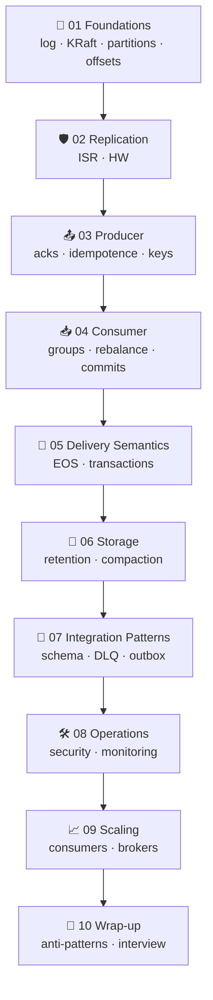

# Apache Kafka — بالتفصيل الممل

> من الصفر للـ production: 39 مفهوم بـ 10 أقسام (كل ملف فكرة وحدة، < 2 دقيقة) + 13 مثال .NET 10 شغّالين على cluster حقيقي (KRaft).



## Layout
```text
docs/
├── 01-foundations/           01-08   + README.md (section index)
├── 02-replication/           09-10
├── 03-producer/              11-14
├── 04-consumer/              15-18
├── 05-delivery-semantics/    19-20
├── 06-storage/               21-22
├── 07-integration-patterns/  23-27
├── 08-operations/            28-33
├── 09-scaling/               34-35
└── 10-wrap-up/               36-39
examples/dotnet/              13 runnable projects
docker/                       cluster + scale-out lab
```

## Quick start
```bash
docker compose -f docker/docker-compose.yml -p kafka-learn up -d   # 3 brokers + UI
cd examples/dotnet && dotnet build
dotnet run --project 01-Admin                                      # see the cluster
start http://localhost:8088                                        # Kafka UI
```
| Endpoint | Value |
|---|---|
| Bootstrap (host) | `localhost:29092,localhost:29093,localhost:29094` |
| Bootstrap (inside Docker) | `kafka-1:19092,kafka-2:19092,kafka-3:19092` |
| Kafka UI | http://localhost:8088 |

## Map

### 🧱 01 · Foundations — الأساسيات → [docs/01-foundations](docs/01-foundations/README.md)
| # | Idea | File |
|---|---|---|
| 01 | What is Kafka? | [01](docs/01-foundations/01-what-is-kafka.md) |
| 02 | The Commit Log | [02](docs/01-foundations/02-commit-log.md) |
| 03 | Broker & Cluster | [03](docs/01-foundations/03-broker-cluster.md) |
| 04 | KRaft (and goodbye ZooKeeper) | [04](docs/01-foundations/04-kraft.md) |
| 05 | Topics | [05](docs/01-foundations/05-topics.md) |
| 06 | Partitions | [06](docs/01-foundations/06-partitions.md) |
| 07 | Offsets (كل الأنواع) | [07](docs/01-foundations/07-offsets.md) |
| 08 | Record Anatomy | [08](docs/01-foundations/08-record-anatomy.md) |

### 🛡️ 02 · Replication — النسخ والموثوقية → [docs/02-replication](docs/02-replication/README.md)
| # | Idea | File |
|---|---|---|
| 09 | Replication: Leader & Followers | [09](docs/02-replication/09-replication.md) |
| 10 | ISR, High Watermark, min.insync.replicas | [10](docs/02-replication/10-isr-hw.md) |

### 📤 03 · Producer — الـ Producer → [docs/03-producer](docs/03-producer/README.md)
| # | Idea | File |
|---|---|---|
| 11 | Producer Internals | [11](docs/03-producer/11-producer-internals.md) |
| 12 | acks & Durability | [12](docs/03-producer/12-acks-durability.md) |
| 13 | Idempotent Producer | [13](docs/03-producer/13-idempotent-producer.md) |
| 14 | Partitioning & Keys | [14](docs/03-producer/14-partitioning-keys.md) |

### 📥 04 · Consumer — الـ Consumer → [docs/04-consumer](docs/04-consumer/README.md)
| # | Idea | File |
|---|---|---|
| 15 | Consumer Poll Loop | [15](docs/04-consumer/15-consumer-poll-loop.md) |
| 16 | Consumer Groups | [16](docs/04-consumer/16-consumer-groups.md) |
| 17 | Rebalancing | [17](docs/04-consumer/17-rebalancing.md) |
| 18 | Offset Commit Strategies | [18](docs/04-consumer/18-offset-commit.md) |

### 🎯 05 · Delivery Semantics — ضمانات التوصيل → [docs/05-delivery-semantics](docs/05-delivery-semantics/README.md)
| # | Idea | File |
|---|---|---|
| 19 | Delivery Semantics | [19](docs/05-delivery-semantics/19-delivery-semantics.md) |
| 20 | Transactions & Exactly-Once (EOS) | [20](docs/05-delivery-semantics/20-transactions-eos.md) |

### 💾 06 · Storage — التخزين → [docs/06-storage](docs/06-storage/README.md)
| # | Idea | File |
|---|---|---|
| 21 | Retention & Log Compaction | [21](docs/06-storage/21-retention-compaction.md) |
| 22 | Storage Internals: ليش Kafka سريعة؟ | [22](docs/06-storage/22-storage-internals.md) |

### 🔌 07 · Integration Patterns — أنماط التكامل → [docs/07-integration-patterns](docs/07-integration-patterns/README.md)
| # | Idea | File |
|---|---|---|
| 23 | Serialization & Schema Registry | [23](docs/07-integration-patterns/23-serialization-schema.md) |
| 24 | Error Handling: Retry & DLQ | [24](docs/07-integration-patterns/24-error-handling-dlq.md) |
| 25 | Transactional Outbox | [25](docs/07-integration-patterns/25-outbox-pattern.md) |
| 26 | Kafka Connect | [26](docs/07-integration-patterns/26-kafka-connect.md) |
| 27 | Stream Processing: Kafka Streams, ksqlDB, Flink | [27](docs/07-integration-patterns/27-stream-processing.md) |

### 🛠️ 08 · Operations — التشغيل → [docs/08-operations](docs/08-operations/README.md)
| # | Idea | File |
|---|---|---|
| 28 | Security: TLS, SASL, ACLs | [28](docs/08-operations/28-security.md) |
| 29 | Monitoring | [29](docs/08-operations/29-monitoring.md) |
| 30 | UI & Tools | [30](docs/08-operations/30-ui-tools.md) |
| 31 | CLI Cheatsheet | [31](docs/08-operations/31-cli-cheatsheet.md) |
| 32 | Sizing: كم partition؟ كم broker؟ | [32](docs/08-operations/32-partition-sizing.md) |
| 33 | Kafka 4.x: الجديد | [33](docs/08-operations/33-kafka-4x-new-features.md) |

### 📈 09 · Scaling — التوسّع (Scale Out) → [docs/09-scaling](docs/09-scaling/README.md)
| # | Idea | File |
|---|---|---|
| 34 | Scale Out: Consumers & Partitions | [34](docs/09-scaling/34-scaling-consumers-partitions.md) |
| 35 | Scale Out: Brokers (Docker lab) | [35](docs/09-scaling/35-scaling-brokers.md) |

### 🏁 10 · Wrap-up — الخلاصة → [docs/10-wrap-up](docs/10-wrap-up/README.md)
| # | Idea | File |
|---|---|---|
| 36 | Use Cases (ومتى لا) | [36](docs/10-wrap-up/36-use-cases.md) |
| 37 | Anti-Patterns | [37](docs/10-wrap-up/37-anti-patterns.md) |
| 38 | Best Practices (Production Checklist) | [38](docs/10-wrap-up/38-best-practices.md) |
| 39 | Self-Test (أسئلة مقابلات) | [39](docs/10-wrap-up/39-interview-questions.md) |

## .NET examples → [examples/dotnet/README.md](examples/dotnet/README.md)

## تصحيحات على نص Gemini الأصلي
| Gemini | الصح | Doc |
|---|---|---|
| "Zookeeper / KRraft" (الاثنين خيارات) | Kafka 4.0 **شالت ZooKeeper**؛ KRaft الوحيد | [04](docs/01-foundations/04-kraft.md) |
| `provectuslabs/kafka-ui` | مهجور ⇒ `ghcr.io/kafbat/kafka-ui` | [30](docs/08-operations/30-ui-tools.md) |
| "Offset Explorer (سابقاً Burrow / Kafka Tool)" | سابقاً Kafka Tool فقط؛ Burrow أداة lag | [30](docs/08-operations/30-ui-tools.md) |
| Key ⇒ ترتيب (بدون تفاصيل) | .NET default partitioner ≠ Java ⇒ `Murmur2Random` | [14](docs/03-producer/14-partitioning-keys.md) |

## Stop
```bash
docker compose -f docker/docker-compose.yml -p kafka-learn down    # wipes all data
```
