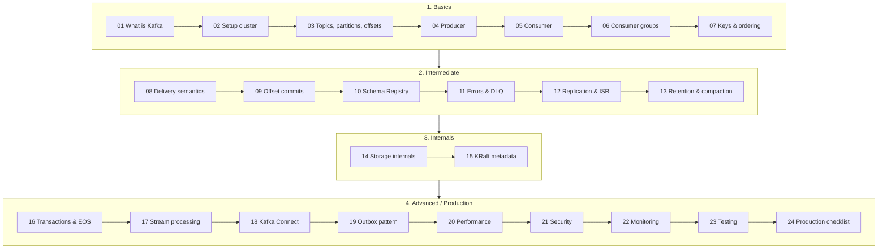

# Apache Kafka: Zero to Hero (with C#)

A hands-on path from "what is an event?" to exactly-once pipelines, for .NET developers. Every topic has a short doc, diagrams, and a runnable C# example with its **real** output.

## Roadmap



| # | Topic | Goal | Level |
|---|---|---|---|
| 01 | [What is Kafka](docs/01-what-is-kafka.md) | Understand the event log and send/read your first event | Beginner |
| 02 | [Setup cluster](docs/02-setup-cluster.md) | Run a 3-node KRaft cluster with Docker and inspect it from C# | Beginner |
| 03 | [Topics, partitions, offsets](docs/03-topics-partitions-offsets.md) | Know how data is laid out and addressed | Beginner |
| 04 | [Producer](docs/04-producer.md) | Send events: await vs callback, headers, flush | Beginner |
| 05 | [Consumer](docs/05-consumer.md) | Poll loop, auto offset reset, graceful shutdown | Beginner |
| 06 | [Consumer groups & rebalancing](docs/06-consumer-groups.md) | Scale reads; see partitions move between consumers | Beginner |
| 07 | [Keys & ordering](docs/07-keys-ordering.md) | Guarantee per-key order; avoid the .NET/Java partitioner trap | Beginner |
| 08 | [Delivery semantics](docs/08-delivery-semantics.md) | `acks`, retries, idempotent producer, latency cost | Intermediate |
| 09 | [Offset commits](docs/09-offset-commits.md) | At-least-once vs at-most-once, proven with a crash | Intermediate |
| 10 | [Serialization & Schema Registry](docs/10-serialization-schema-registry.md) | Typed events, wire format, schema evolution | Intermediate |
| 11 | [Errors, retries & DLQ](docs/11-errors-retries-dlq.md) | Retry transient errors, park poison messages | Intermediate |
| 12 | [Replication & ISR](docs/12-replication-isr.md) | Survive broker failures; `min.insync.replicas` | Intermediate |
| 13 | [Retention & compaction](docs/13-retention-compaction.md) | Delete vs compact; tombstones | Intermediate |
| 14 | [Storage internals](docs/14-storage-internals.md) | Segments, indexes, time lookups | Advanced |
| 15 | [KRaft & metadata](docs/15-kraft-metadata.md) | Controllers, quorum, `__cluster_metadata` | Advanced |
| 16 | [Transactions & exactly-once](docs/16-transactions-eos.md) | Atomic writes, read_committed, consume-transform-produce | Advanced |
| 17 | [Stream processing](docs/17-stream-processing.md) | Stateful counting with Streamiz (Kafka Streams for .NET) | Advanced |
| 18 | [Kafka Connect](docs/18-kafka-connect.md) | Move data in/out of Kafka without code | Advanced |
| 19 | [Outbox pattern](docs/19-outbox-pattern.md) | Reliable DB + Kafka writes without 2PC | Advanced |
| 20 | [Performance tuning](docs/20-performance-tuning.md) | Batching, linger, compression with real numbers | Advanced |
| 21 | [Security](docs/21-security.md) | SASL authentication and ACL authorization | Advanced |
| 22 | [Monitoring](docs/22-monitoring.md) | Consumer lag and client statistics | Advanced |
| 23 | [Testing](docs/23-testing.md) | Integration tests with Testcontainers | Advanced |
| 24 | [Production checklist](docs/24-production-checklist.md) | Safe defaults and a config linter | Advanced |

## Quick start

```bash
docker compose up -d                       # 3-node Kafka 4.1 cluster (KRaft, no ZooKeeper)
cd examples/01-hello-kafka && dotnet run   # any example: cd examples/NN-<topic> && dotnet run
```

Optional services (only the examples that need them):

| Command | Adds | Used by |
|---|---|---|
| `docker compose --profile ui up -d` | Kafka UI → http://localhost:8080 | browsing everything |
| `docker compose --profile registry up -d` | Schema Registry → http://localhost:8081 | 10 |
| `docker compose --profile connect up -d` | Kafka Connect → http://localhost:8083 | 18 |
| `docker compose --profile security up -d` | SASL + ACL broker → localhost:9192 | 21 |

Tear down: `docker compose --profile "*" down -v`.

## Prerequisites

| Tool | Version |
|---|---|
| .NET SDK | 10.0 |
| Docker + Compose | Docker 24+, Compose v2 |
| Kafka image | `apache/kafka:4.1.0` |
| C# client | `Confluent.Kafka` 2.15.1 (wraps librdkafka) |
| RAM | ~3 GB free for the 3 brokers |

## Repo layout

```
.
├── README.md                 roadmap (this file)
├── docker-compose.yml        3-node cluster + optional UI / Registry / Connect / secure broker
├── connect/                  Kafka Connect worker config + data folder
├── docs/NN-<topic>.md        one concept per file
└── examples/
    ├── Kafka.Examples.slnx   all examples in one solution
    └── NN-<topic>/           runnable C# for docs/NN
```

## How each doc is built

1. **Definition** (one line) → 2. **Why it matters** → 3. **Example story** (real values) → 4. **Diagram** → 5. **C# code + real output** → 6. **✅ / ❌ usage** → 7. **Pitfalls** → 8. **Next**.

All outputs in the docs were produced by running the examples against the compose cluster. Numbers (offsets, latencies, partitions) will differ slightly on your machine.
