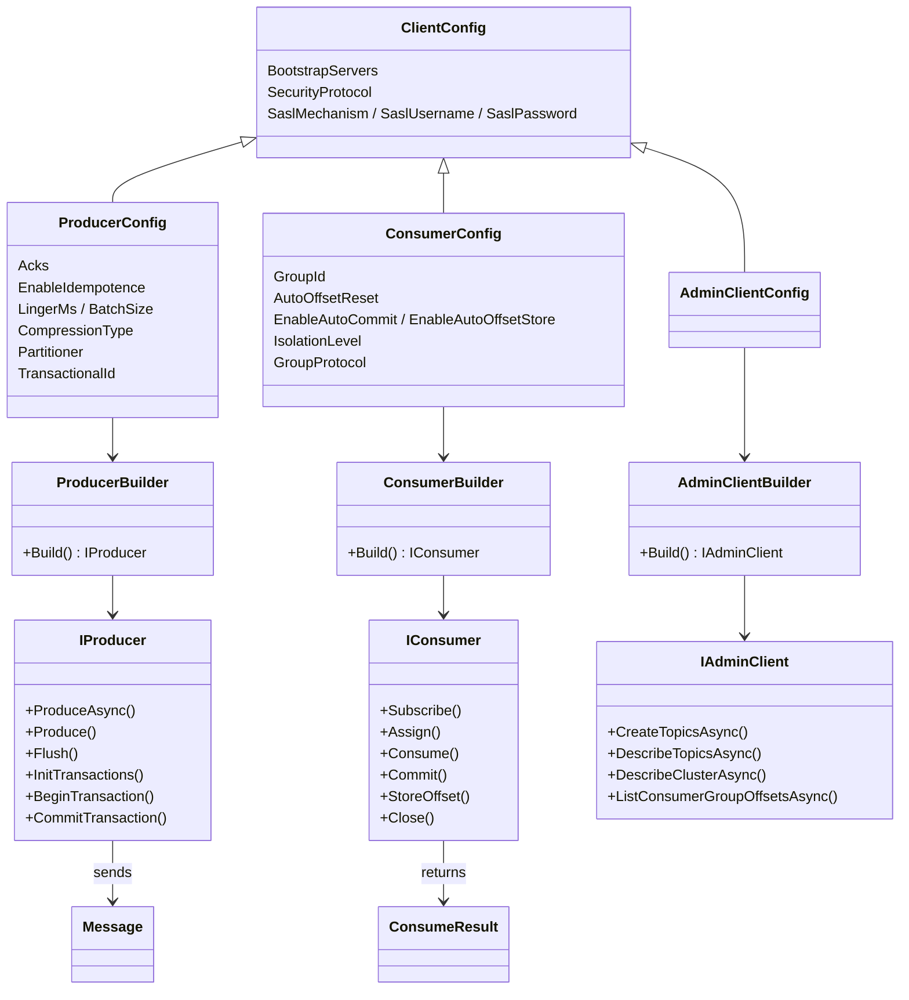
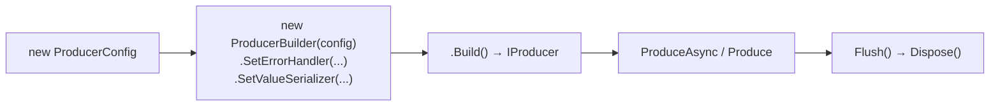

# 00 · Kafka C# API cheat sheet

**Definition:** Every C# Kafka class, method, and setting used in this repo, with what it does and which doc shows it running.

**How to use:** look up an API here, then open the linked doc to see it in a real run with real output.

## Packages

| NuGet package | Version | What it gives you | Docs |
|---|---|---|---|
| `Confluent.Kafka` | 2.15.1 | Producer, consumer, admin client (wraps the C library **librdkafka**) | all |
| `Confluent.SchemaRegistry.Serdes.Json` | 2.15.1 | JSON Schema serializer/deserializer + Schema Registry client | [10](10-serialization-schema-registry.md) |
| `Streamiz.Kafka.Net` | 1.8.2 | Kafka Streams for .NET: filter, map, aggregate, windows, joins | [17](17-stream-processing.md), [29](29-streams-windows-joins.md) |
| `Microsoft.Extensions.Hosting` | 10.0.0 | Generic Host, DI, `BackgroundService` | [30](30-background-service.md) |
| `Testcontainers.Kafka` | 4.16.0 | Throw-away Kafka container for integration tests | [23](23-testing.md) |
| `Microsoft.Data.Sqlite` / `Npgsql` | 10.0.0 | Databases for the outbox and CDC demos | [19](19-outbox-pattern.md), [31](31-debezium-cdc.md) |

## Class map



Every client follows the same three steps: **Config → Builder → Build() → use → Dispose**.



## 1. Configuration

| Property | Example | What it does | Doc |
|---|---|---|---|
| `BootstrapServers` | `"localhost:9092,localhost:9094,localhost:9096"` | First brokers to contact; the client discovers the rest | [02](02-setup-cluster.md) |
| `ClientId` | `"payments-api"` | Name shown in broker logs and metrics | [04](04-producer.md) |
| `Acks` | `Acks.All` | How many replicas must store a write: `None`, `Leader`, `All` | [08](08-delivery-semantics.md) |
| `EnableIdempotence` | `true` | No duplicates or reordering when the producer retries | [08](08-delivery-semantics.md) |
| `LingerMs` | `20` | Wait up to N ms to fill bigger batches | [20](20-performance-tuning.md) |
| `BatchSize` | `256 * 1024` | Max bytes per partition batch | [20](20-performance-tuning.md) |
| `CompressionType` | `CompressionType.Zstd` | Compress batches (`None`, `Gzip`, `Snappy`, `Lz4`, `Zstd`) | [20](20-performance-tuning.md) |
| `Partitioner` | `Partitioner.Murmur2Random` | Key hash; use murmur2 for Java compatibility | [07](07-keys-ordering.md) |
| `MessageTimeoutMs` | `5000` | Give up delivering after N ms | [12](12-replication-isr.md) |
| `MessageSendMaxRetries` | `0` | Client-side retries (0 shows the broker's error directly) | [12](12-replication-isr.md) |
| `QueueBufferingMaxMessages` | `500_000` | Size of the local send queue | [20](20-performance-tuning.md) |
| `StatisticsIntervalMs` | `1000` | Emit a JSON statistics document every N ms | [22](22-monitoring.md) |
| `TransactionalId` | `"16-ledger-writer-0"` | Turns on transactions; stable id per instance | [16](16-transactions-eos.md) |
| `GroupId` | `"05-shipment-tracker"` | Consumer group name | [05](05-consumer.md) |
| `AutoOffsetReset` | `AutoOffsetReset.Earliest` | Where to start when the group has no committed offset | [05](05-consumer.md) |
| `EnableAutoCommit` | `false` | Turn background commits off; you call `Commit()` | [09](09-offset-commits.md) |
| `EnableAutoOffsetStore` | `false` | Only offsets you `StoreOffset()` get auto-committed | [22](22-monitoring.md), [30](30-background-service.md) |
| `IsolationLevel` | `IsolationLevel.ReadCommitted` | Hide aborted transactional records | [16](16-transactions-eos.md) |
| `PartitionAssignmentStrategy` | `PartitionAssignmentStrategy.CooperativeSticky` | Incremental rebalances (classic protocol) | [06](06-consumer-groups.md) |
| `GroupProtocol` | `GroupProtocol.Consumer` | New KIP-848 protocol: the broker assigns partitions | [06](06-consumer-groups.md) |
| `SessionTimeoutMs` / `HeartbeatIntervalMs` | `6000` / `1000` | Failure detection for the classic protocol | [06](06-consumer-groups.md) |
| `FetchMinBytes` / `FetchWaitMaxMs` | `1_000_000` / `3000` | Broker holds a fetch until N bytes or N ms | [25](25-request-lifecycle.md) |
| `SecurityProtocol` | `SecurityProtocol.SaslSsl` | `Plaintext`, `Ssl`, `SaslPlaintext`, `SaslSsl` | [21](21-security.md) |
| `SaslMechanism` / `SaslUsername` / `SaslPassword` | `SaslMechanism.Plain`, `"alice"`, `"..."` | Login credentials | [21](21-security.md) |

## 2. Producer

| API | Code | What it does | Doc |
|---|---|---|---|
| Build | `new ProducerBuilder<string, string>(config).Build()` | Creates a thread-safe producer; create **once** per app | [04](04-producer.md) |
| Message | `new Message<string, string> { Key = "pay-1", Value = "...", Headers = h, Timestamp = t }` | One record: key, value, headers, timestamp | [04](04-producer.md) |
| Headers | `new Headers { { "event-type", Encoding.UTF8.GetBytes("PaymentCreated") } }` | Metadata as byte arrays | [04](04-producer.md), [11](11-errors-retries-dlq.md) |
| Event time | `Timestamp = new Timestamp(dateTimeUtc)` | Sets the record's CreateTime (used by windows and `OffsetsForTimes`) | [14](14-storage-internals.md), [29](29-streams-windows-joins.md) |
| Await send | `await producer.ProduceAsync(topic, message)` | Sends and waits for the ack; returns `DeliveryResult` | [04](04-producer.md) |
| Fixed partition | `await producer.ProduceAsync(new TopicPartition(topic, 2), message)` | Writes to one explicit partition | [03](03-topics-partitions-offsets.md) |
| Fire + callback | `producer.Produce(topic, message, report => { ... })` | Queues and returns at once; the callback runs on delivery | [04](04-producer.md), [20](20-performance-tuning.md) |
| Flush | `producer.Flush(TimeSpan.FromSeconds(10))` | Waits for queued messages; returns how many are still queued | [04](04-producer.md) |
| Result fields | `result.Partition.Value`, `result.Offset.Value`, `result.Status`, `result.TopicPartitionOffset` | Where the record landed; `Status` is `Persisted` / `PossiblyPersisted` / `NotPersisted` | [04](04-producer.md), [08](08-delivery-semantics.md) |
| Error type | `catch (ProduceException<string, string> ex)` → `ex.Error.Code` | Failed delivery, e.g. `NotEnoughReplicas`, `Local_MsgTimedOut` | [12](12-replication-isr.md) |
| Error handler | `.SetErrorHandler((_, e) => ...)` | Connection and authentication errors (e.g. `Local_Authentication`) | [21](21-security.md) |
| Log handler | `.SetLogHandler((_, m) => { })` | Captures or silences librdkafka log lines | [12](12-replication-isr.md) |
| Stats handler | `.SetStatisticsHandler((_, json) => ...)` | JSON metrics: `txmsgs`, broker `rtt`, queue size | [22](22-monitoring.md) |
| Serializer | `.SetValueSerializer(new JsonSerializer<Order>(registry))` | Converts objects to bytes | [10](10-serialization-schema-registry.md) |

```csharp
// minimal production producer
var config = new ProducerConfig
{
    BootstrapServers = "localhost:9092",
    Acks = Acks.All,
    EnableIdempotence = true,
    LingerMs = 10,
    CompressionType = CompressionType.Lz4
};

using var producer = new ProducerBuilder<string, string>(config).Build();

var result = await producer.ProduceAsync("orders", new Message<string, string> { Key = "ord-1", Value = "{\"total\":120}" });

Console.WriteLine($"stored at p{result.Partition.Value}@{result.Offset.Value}");

producer.Flush(TimeSpan.FromSeconds(10));
```

## 3. Consumer

| API | Code | What it does | Doc |
|---|---|---|---|
| Build | `new ConsumerBuilder<string, string>(config).Build()` | Creates a consumer; **not** thread-safe, one per loop | [05](05-consumer.md) |
| Subscribe | `consumer.Subscribe("orders")` | Joins the group; partitions are assigned automatically | [05](05-consumer.md) |
| Assign | `consumer.Assign(new TopicPartitionOffset(topic, 0, Offset.Beginning))` | Reads chosen partitions/offsets with no group management | [01](01-what-is-kafka.md), [07](07-keys-ordering.md) |
| Special offsets | `Offset.Beginning`, `Offset.End`, `Offset.Unset` | Start of log, end of log, unknown | [03](03-topics-partitions-offsets.md), [25](25-request-lifecycle.md) |
| Consume (timeout) | `consumer.Consume(TimeSpan.FromSeconds(5))` | Next record, or `null` on timeout | [09](09-offset-commits.md) |
| Consume (token) | `consumer.Consume(cancellationToken)` | Blocks until a record arrives; throws `OperationCanceledException` | [05](05-consumer.md), [30](30-background-service.md) |
| Result fields | `r.Message.Key`, `r.Message.Value`, `r.Partition`, `r.Offset`, `r.LeaderEpoch`, `r.Message.Headers` | The record plus its position | [05](05-consumer.md), [25](25-request-lifecycle.md) |
| Read header | `r.Message.Headers.GetLastBytes("event-id")` / `TryGetLastBytes` | Gets a header value | [33](33-event-patterns.md) |
| Commit one | `consumer.Commit(record)` | Synchronously commits `record.Offset + 1` | [09](09-offset-commits.md) |
| Commit stored | `consumer.Commit()` | Commits all stored offsets | [22](22-monitoring.md) |
| Store offset | `consumer.StoreOffset(record)` | Marks the record done; auto-commit sends it later | [30](30-background-service.md) |
| Watermarks | `consumer.QueryWatermarkOffsets(tp, timeout)` → `.Low`, `.High` | First stored offset / next offset to write | [03](03-topics-partitions-offsets.md), [22](22-monitoring.md) |
| Seek by time | `consumer.OffsetsForTimes([new TopicPartitionTimestamp(tp, ts)], timeout)` | First offset at or after a timestamp | [14](14-storage-internals.md) |
| Rebalance hooks | `.SetPartitionsAssignedHandler(...)` / `.SetPartitionsRevokedHandler(...)` | Runs code when partitions move | [06](06-consumer-groups.md) |
| Current assignment | `consumer.Assignment` | Partitions this consumer owns now | [06](06-consumer-groups.md) |
| Group metadata | `consumer.ConsumerGroupMetadata` | Passed to transactions (`SendOffsetsToTransaction`) | [16](16-transactions-eos.md) |
| Close | `consumer.Close()` | Final commit + leave group (fast rebalance for the others) | [05](05-consumer.md) |
| Deserializer | `.SetValueDeserializer(new JsonDeserializer<Order>().AsSyncOverAsync())` | Converts bytes to objects | [10](10-serialization-schema-registry.md) |

```csharp
// minimal at-least-once consumer loop
var config = new ConsumerConfig
{
    BootstrapServers = "localhost:9092",
    GroupId = "billing",
    AutoOffsetReset = AutoOffsetReset.Earliest,
    EnableAutoOffsetStore = false
};

using var consumer = new ConsumerBuilder<string, string>(config).Build();

consumer.Subscribe("orders");

try
{
    while (!token.IsCancellationRequested)
    {
        var record = consumer.Consume(token);

        Handle(record.Message.Value);

        // only processed records get committed
        consumer.StoreOffset(record);
    }
}
catch (OperationCanceledException) { }
finally
{
    consumer.Close();
}
```

## 4. Admin client

| API | Code | What it does | Doc |
|---|---|---|---|
| Build | `new AdminClientBuilder(new AdminClientConfig { BootstrapServers = b }).Build()` | Management client | [02](02-setup-cluster.md) |
| Create topic | `await admin.CreateTopicsAsync([new TopicSpecification { Name, NumPartitions, ReplicationFactor, Configs }])` | Creates topics with partitions, RF and configs | [03](03-topics-partitions-offsets.md), [13](13-retention-compaction.md) |
| Delete topic | `await admin.DeleteTopicsAsync([topic])` | Deletes topics (throws `DeleteTopicsException` if missing) | most |
| Describe topic | `await admin.DescribeTopicsAsync(TopicCollection.OfTopicNames([topic]))` | Leader, replicas and ISR per partition | [03](03-topics-partitions-offsets.md), [12](12-replication-isr.md) |
| Describe cluster | `await admin.DescribeClusterAsync()` → `ClusterId`, `Nodes`, `Controller` | Brokers; in KRaft `Controller` is a random broker | [02](02-setup-cluster.md), [15](15-kraft-metadata.md) |
| Metadata | `admin.GetMetadata(timeout).Topics` | All topics and their partitions | [24](24-production-checklist.md) |
| Configs | `await admin.DescribeConfigsAsync([new ConfigResource { Type = ResourceType.Topic, Name = t }])` | Effective configs (only one BROKER resource per call) | [15](15-kraft-metadata.md), [24](24-production-checklist.md) |
| Group offsets | `await admin.ListConsumerGroupOffsetsAsync([new ConsumerGroupTopicPartitions(group, partitions)])` | Committed offsets → lag | [22](22-monitoring.md), [32](32-mirrormaker-dr.md) |
| Describe group | `await admin.DescribeConsumerGroupsAsync([group])` → `State`, `Members`, `Coordinator` | Who is in the group and what each member owns | [26](26-group-coordinator.md) |
| Delete group | `await admin.DeleteGroupsAsync([group])` | Removes an inactive group and its offsets | [09](09-offset-commits.md) |
| ACLs | `await admin.CreateAclsAsync([new AclBinding { Pattern, Entry }])` / `DescribeAclsAsync(filter)` | Grants or lists permissions | [21](21-security.md) |

## 5. Transactions (exactly-once)

| API | Code | What it does | Doc |
|---|---|---|---|
| Enable | `new ProducerConfig { TransactionalId = "writer-0" }` | One stable id per instance (fences zombies) | [16](16-transactions-eos.md) |
| Init | `producer.InitTransactions(timeout)` | Registers with the coordinator, bumps the epoch | [16](16-transactions-eos.md) |
| Begin | `producer.BeginTransaction()` | Starts a group of writes | [16](16-transactions-eos.md) |
| Offsets in tx | `producer.SendOffsetsToTransaction([tpo], consumer.ConsumerGroupMetadata, timeout)` | Commits consumer progress in the same transaction | [16](16-transactions-eos.md) |
| Commit | `producer.CommitTransaction()` | Makes all writes visible together | [16](16-transactions-eos.md) |
| Abort | `producer.Flush(...); producer.AbortTransaction()` | Discards the writes (`Flush` first, or queued records are purged) | [16](16-transactions-eos.md) |
| Read side | `IsolationLevel = IsolationLevel.ReadCommitted` | Consumers skip aborted records | [16](16-transactions-eos.md) |

## 6. Schema Registry

| API | Code | What it does | Doc |
|---|---|---|---|
| Client | `new CachedSchemaRegistryClient(new SchemaRegistryConfig { Url = "http://localhost:8081" })` | Talks to the registry, caches schemas | [10](10-serialization-schema-registry.md) |
| Serializer | `new JsonSerializer<Order>(registry)` | Generates and registers the schema; writes `0x00` + schema id + JSON | [10](10-serialization-schema-registry.md) |
| Deserializer | `new JsonDeserializer<Order>().AsSyncOverAsync()` | Reads the wire format back into `Order` | [10](10-serialization-schema-registry.md) |
| Latest schema | `await registry.GetLatestSchemaAsync("orders-value")` | Version, id, schema text | [10](10-serialization-schema-registry.md) |
| Register | `await registry.RegisterSchemaAsync(subject, new Schema(text, SchemaType.Json))` | Adds a version; HTTP 409 if incompatible | [10](10-serialization-schema-registry.md) |
| Compatibility | `await registry.GetCompatibilityAsync()` | Global rule, e.g. `Backward` | [10](10-serialization-schema-registry.md) |

## 7. Streamiz (stream processing)

| API | Code | What it does | Doc |
|---|---|---|---|
| Config | `new StreamConfig<StringSerDes, StringSerDes> { ApplicationId, BootstrapServers, ... }` | App id = consumer group + prefix for internal topics | [17](17-stream-processing.md) |
| Quiet logs | `Logger = LoggerFactory.Create(b => b.SetMinimumLevel(LogLevel.Warning))` | Hides Streamiz info logs | [17](17-stream-processing.md) |
| Source | `builder.Stream<string, string>("orders")` | KStream: every record is an event | [17](17-stream-processing.md) |
| Table | `builder.Table("customers", InMemory.As<string, string>("store"))` | KTable: latest value per key | [29](29-streams-windows-joins.md) |
| Filter | `.Filter((k, v, _) => decimal.Parse(v) >= 100)` | Keeps matching records | [17](17-stream-processing.md) |
| Map values | `.MapValues((v, _) => v.ToString())` | Changes the value only (no repartition) | [17](17-stream-processing.md) |
| Map | `.Map((k, v, _) => KeyValuePair.Create(newKey, newValue))` | Changes key and value | [29](29-streams-windows-joins.md) |
| Group | `.GroupByKey()` | Prepares for aggregation by the existing key | [17](17-stream-processing.md) |
| Window | `.WindowedBy(TumblingWindowOptions.Of(TimeSpan.FromSeconds(10)))` | Event-time buckets | [29](29-streams-windows-joins.md) |
| Count | `.Count(InMemory.As<string, long>("store"))` / `InMemoryWindows.As<...>` | Stateful count with a state store | [17](17-stream-processing.md), [29](29-streams-windows-joins.md) |
| Join | `.Join(table, (order, tier) => $"{order} (tier={tier})")` | KStream–KTable inner join | [29](29-streams-windows-joins.md) |
| To stream | `.ToStream()` | Table changes → stream of updates | [17](17-stream-processing.md) |
| Sink | `.To("output-topic")` | Writes results | [17](17-stream-processing.md) |
| Run | `var s = new KafkaStream(builder.Build(), config); await s.StartAsync(); ... s.Dispose();` | Starts and stops processing | [17](17-stream-processing.md) |
| Topology | `builder.Build().Describe()` | Prints the processor graph | [17](17-stream-processing.md) |

## 8. Hosting, Connect, testing

| API | Code | What it does | Doc |
|---|---|---|---|
| Singleton producer | `services.AddSingleton(_ => new ProducerBuilder<string, string>(cfg).Build())` | One producer for the whole app | [30](30-background-service.md) |
| Consumer service | `class Worker : BackgroundService` + `Task.Factory.StartNew(Run, TaskCreationOptions.LongRunning)` | Consume loop on its own thread | [30](30-background-service.md) |
| Flush on stop | `override StopAsync(...) { producer.Flush(...) }` | No lost messages on SIGTERM | [30](30-background-service.md) |
| Connect REST | `await http.PostAsJsonAsync("/connectors", new { name, config })` | Creates a connector (FileStream, Debezium …) | [18](18-kafka-connect.md), [31](31-debezium-cdc.md) |
| Connector status | `await http.GetFromJsonAsync<JsonElement>($"/connectors/{name}/status")` | RUNNING / FAILED per task | [18](18-kafka-connect.md) |
| Test container | `new KafkaBuilder("apache/kafka:4.1.0").Build()` + `StartAsync()` | Real broker for a test class | [23](23-testing.md) |
| Test bootstrap | `_kafka.GetBootstrapAddress()` | Random host port of the container | [23](23-testing.md) |

## 9. Error codes you will meet

| `ErrorCode` | Meaning | Seen in |
|---|---|---|
| `NotEnoughReplicas` | ISR < `min.insync.replicas` with `acks=all` | [12](12-replication-isr.md) |
| `Local_MsgTimedOut` | Not delivered within `message.timeout.ms` | [12](12-replication-isr.md) |
| `TopicAuthorizationFailed` | Authenticated but no ACL allows it | [21](21-security.md) |
| `Local_Authentication` | Wrong username/password | [21](21-security.md) |
| `InvalidConfig` | Broker rejected a topic config (e.g. tiered storage disabled) | [28](28-tiered-storage.md) |
| `Local_QueueFull` | `Produce()` faster than the network; back off | [20](20-performance-tuning.md) |
| `ProducerFenced` | Another instance took your `TransactionalId` | [16](16-transactions-eos.md) |

## ✅ Correct vs ❌ wrong usage

| | Usage | Reason |
|---|---|---|
| ✅ | One `IProducer` per app, many `IConsumer`s (one per loop/thread) | Producer is thread-safe; consumer is not |
| ✅ | `using` / `Dispose` on every client | Releases librdkafka threads and sockets |
| ✅ | `Commit(record)` or `StoreOffset(record)` **after** processing | At-least-once |
| ❌ | `ProduceAsync(...).Result` | Blocks a thread per message |
| ❌ | Calling `Consume()` from several threads on one consumer | Undefined behavior |

**Next:** start the roadmap at [01 · What is Kafka](01-what-is-kafka.md).
