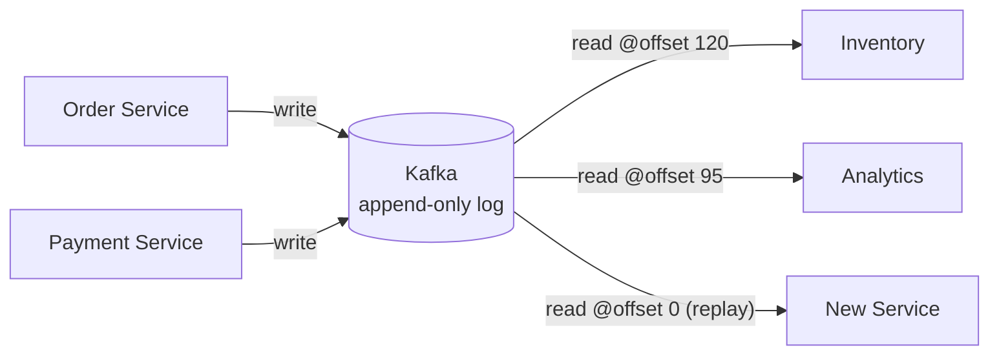

# 01 · What is Kafka?

> **Distributed commit log**: الـ events بتنكتب مرة وحدة وبتنقرأ من أي عدد consumers، بأي وقت، وبأي سرعة.

## 3 أدوار بنفس الوقت
| الدور | يعني | مثال |
|---|---|---|
| Messaging | Pub/Sub بين services | `OrderCreated` → Inventory + Email |
| Storage | بيحتفظ بالداتا أيام/للأبد | replay لآخر 7 أيام |
| Processing | يعالج الـ stream وهو ماشي | Kafka Streams / Flink |

## Kafka vs Queue vs Database
| | RabbitMQ (queue) | Kafka (log) | PostgreSQL (DB) |
|---|---|---|---|
| بعد القراءة | الرسالة **تنحذف** | **تبقى** (retention) | تبقى |
| عدد القرّاء | queue واحد = consumer يأخذها | كل group ياخد نسخة | queries |
| الترتيب | per queue | **per partition** | ORDER BY |
| Replay | ❌ | ✅ seek لأي offset | — |
| Throughput | ~50K msg/s/node | **~1M+ msg/s/node** | — |
| Routing معقد | ✅ exchanges | ❌ (topic فقط) | — |
| نموذج | Push | **Pull** (consumer يسحب) | Query |

## ليش Pull مش Push؟
- consumer بطيء ما بينضغط (backpressure طبيعي)
- كل consumer بيقرأ بسرعته
- batching: يسحب 500 record بطلب واحد

## Numbers (LinkedIn, 2024+)
| | Value |
|---|---|
| Messages/day | > 7 trillion |
| Clusters | 100+ |
| Brokers | 4000+ |

## Key Points
- Kafka = **log**, مش queue
- Decoupling: producer ما بيعرف consumers
- القراءة ما بتحذف
- Consumer بيحدد موقعه (offset)

## Pitfall
❌ "Kafka بديل RabbitMQ لكل شي" → ✅ لو بدك routing معقد / priority / per-message TTL → RabbitMQ أنسب.

Next → [02-commit-log.md](02-commit-log.md)
