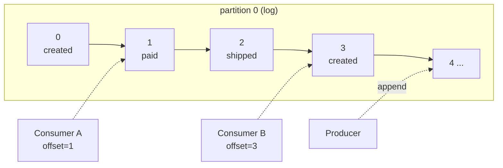

# 02 · The Commit Log

> كل شي بـ Kafka مبني على فكرة وحدة: **ملف append-only** — كتابة بالآخر فقط، ولا تعديل.



## ليش log؟
| خاصية | النتيجة |
|---|---|
| Append-only | كتابة sequential على الديسك = سريعة جداً |
| Immutable | ما في locks على القراءة |
| Ordered (offset) | ترتيب مضمون داخل الـ partition |
| Retained | أكتر من reader، كل واحد بمكانه |

## Sequential vs Random I/O
| Disk | Sequential | Random (4KB) |
|---|---|---|
| HDD 7200rpm | ~200 MB/s | ~1 MB/s |
| NVMe SSD | ~3000 MB/s | ~500 MB/s |

→ لهيك Kafka سريعة حتى على HDD.

## Event vs State
```text
State (DB):   balance = 70
Events (log): +100 (deposit) → -50 (withdraw) → +20 (deposit)
              replay events ⇒ نفس الـ state = 70
```
- الـ log = **source of truth**، الـ DB = **view** مبنية منه (Event Sourcing).

## جرّب
```bash
dotnet run --project examples/dotnet/11-SeekReplay   # replay by offset / by time
```

## Key Points
- ما في update / delete لرسالة
- الحذف = retention أو compaction فقط
- الـ offset = رقم السطر بالملف

Next → [03-broker-cluster.md](03-broker-cluster.md)
