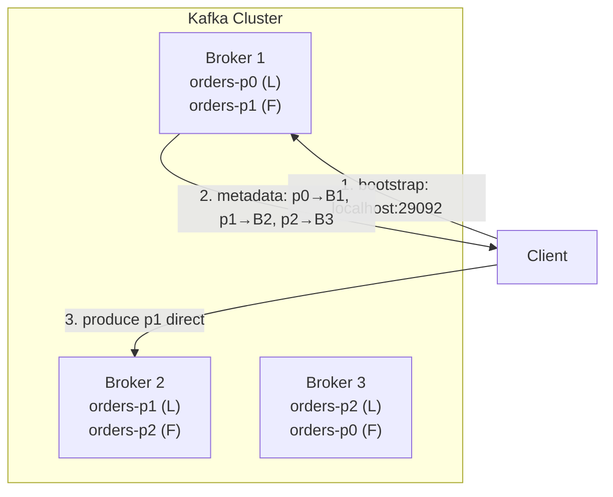
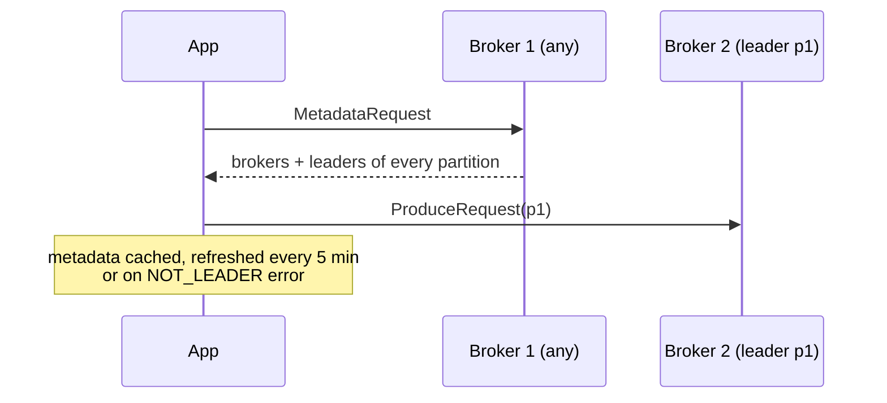

# 03 · Broker & Cluster

> **Broker** = سيرفر Kafka واحد (process). **Cluster** = مجموعة brokers بتتقاسم الـ partitions.



## Bootstrap flow


## Example
```csharp
// أي broker بيكفي — بس حط 3 لو واحد واقع
BootstrapServers = "localhost:29092,localhost:29093,localhost:29094"
```

## Listeners (سبب مشاكل الـ Docker الأشهر)
| Config | يعني |
|---|---|
| `listeners` | وين الـ broker **يسمع** (bind) |
| `advertised.listeners` | العنوان اللي **يعطيه للـ clients** بالـ metadata |

```yaml
KAFKA_LISTENERS:            INTERNAL://:19092,EXTERNAL://:29092
KAFKA_ADVERTISED_LISTENERS: INTERNAL://kafka-1:19092,EXTERNAL://localhost:29092
```

## Numbers
| | Typical |
|---|---|
| Partitions / broker | ≤ 4000 (recommended) |
| Partitions / cluster (KRaft) | millions ممكن |
| Min prod brokers | 3 |

## Key Points
- Client بيحكي مع الـ **leader** مباشرة
- ما في "master broker" للداتا
- Bootstrap = بس أول اتصال

## Pitfall
❌ `advertised.listeners=localhost` بـ Docker والـ app بـ container تاني → `Connection refused` → ✅ listener داخلي باسم الـ container + خارجي لـ localhost.

Next → [04-kraft.md](04-kraft.md)
