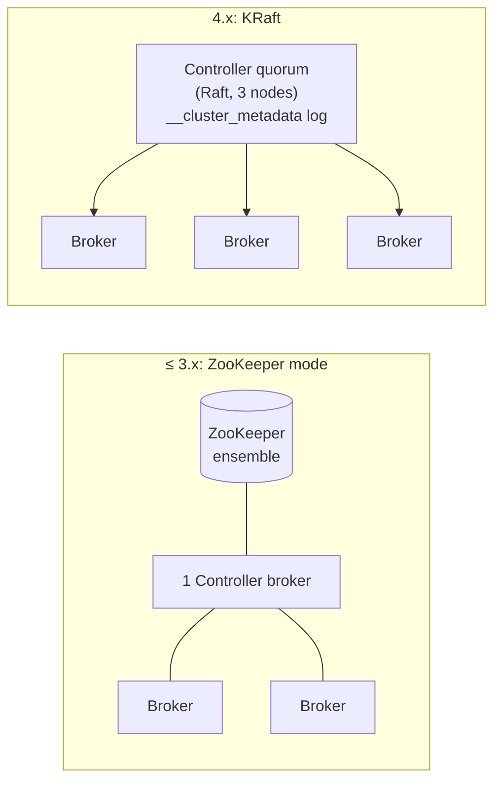
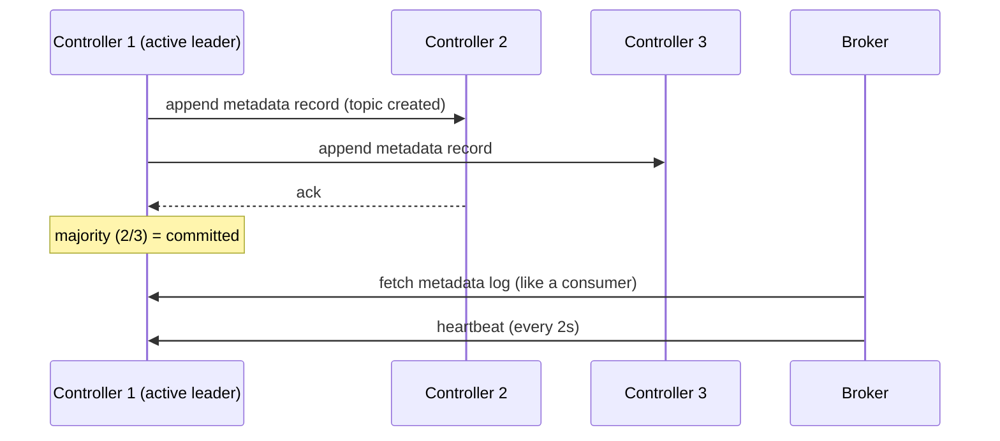

# 04 · KRaft (and goodbye ZooKeeper)

> الـ **metadata** (topics, partitions, leaders, configs, ACLs) صارت بـ Kafka نفسها عبر Raft. **Kafka 4.0 شالت ZooKeeper نهائياً.**

## قبل vs بعد


## كيف بيشتغل


## ZooKeeper vs KRaft
| | ZooKeeper | KRaft |
|---|---|---|
| Systems to run | 2 (Kafka + ZK) | 1 |
| Controller failover | ثواني → دقائق (reload كل metadata) | **ms** (hot standby) |
| Max partitions | ~200K | **millions** |
| Metadata storage | znodes | log `__cluster_metadata` |
| Status | ❌ removed in 4.0 | ✅ only mode |

## Roles
```yaml
KAFKA_PROCESS_ROLES: "broker,controller"   # combined (dev) — مثل docker-compose هون
KAFKA_PROCESS_ROLES: "controller"          # dedicated (prod)
KAFKA_PROCESS_ROLES: "broker"
KAFKA_CONTROLLER_QUORUM_VOTERS: "1@kafka-1:9093,2@kafka-2:9093,3@kafka-3:9093"
```

## Quorum math
| Controllers | Tolerates failures |
|---|---|
| 1 | 0 |
| 3 | 1 |
| 5 | 2 |

## جرّب
```bash
docker exec kafka-1 /opt/kafka/bin/kafka-metadata-quorum.sh --bootstrap-server localhost:19092 describe --status
dotnet run --project examples/dotnet/01-Admin    # prints the active controller
```

## Key Points
- Controller = مدير الـ metadata، مش الداتا
- Odd number: 3 أو 5
- Prod: controllers منفصلين عن brokers

Next → [05-topics.md](05-topics.md)
