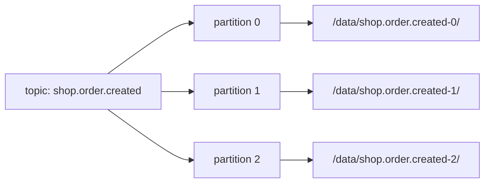

# 05 · Topics

> **Topic** = اسم منطقي لـ stream من events من نفس النوع. فيزيائياً = مجموعة partitions.



## Naming
```text
<domain>.<entity>.<event>[.<version>]
shop.order.created
shop.order.created.dlq
payments.transaction.settled.v2
```
| ✅ | ❌ |
|---|---|
| `shop.order.created` | `topic1`, `test`, `orders_new_final` |
| lowercase + `.` | mixing `.` و `_` (metrics تتلخبط) |

## Create (explicit, never auto)
```csharp
await admin.CreateTopicsAsync([new TopicSpecification
{
    Name = "shop.order.created",
    NumPartitions = 6,
    ReplicationFactor = 3,
    Configs = new()
    {
        ["min.insync.replicas"] = "2",
        ["retention.ms"] = "604800000",   // 7 days
        ["cleanup.policy"] = "delete"
    }
}]);
```

## أهم Topic configs
| Config | Default | يعني |
|---|---|---|
| `retention.ms` | 7 days | قديش تبقى الداتا |
| `retention.bytes` | -1 (∞) | حد الحجم per partition |
| `cleanup.policy` | delete | `delete` / `compact` / both |
| `min.insync.replicas` | 1 | أقل ISR لقبول `acks=all` |
| `max.message.bytes` | ~1 MB | أكبر batch |
| `segment.bytes` | 1 GB | حجم ملف الـ segment |

## Event types: topic واحد ولا كثير؟
| Rule | Example |
|---|---|
| events لازم **ترتيبها مع بعض** → نفس topic | `order.created`, `order.paid` لنفس الـ order |
| schemas مختلفة كلياً → topics منفصلة | `orders` vs `clicks` |

## Key Points
- `auto.create.topics.enable=false` بالـ prod
- Partitions ممكن **تزيد** بس ما تنقص
- Internal topics تبدأ بـ `__`

Next → [06-partitions.md](06-partitions.md)
