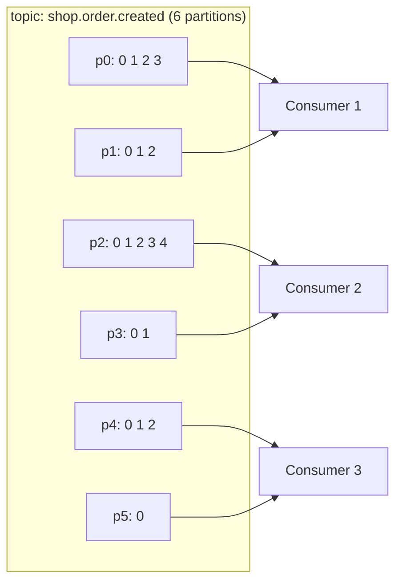

# 06 · Partitions

> **Partition** = log مستقل (ملفات على ديسك broker). هي وحدة: **التوازي، الترتيب، التوزيع، والـ replication**.



## 4 أشياء بتحددها الـ partition
| | القاعدة |
|---|---|
| Ordering | مضمون **داخل** partition فقط، مش بين partitions |
| Parallelism | max consumers فعالين بالـ group = عدد partitions |
| Offsets | كل partition عندها عدّاد offsets خاص فيها (p0@5 ≠ p1@5) |
| Placement | كل partition إلها leader على broker واحد |

## Ordering عبر partitions — مثال
```text
Producer sends:  A1(p0)  B1(p1)  A2(p0)  B2(p1)
Consumer may see: B1 A1 B2 A2   ← A1<A2 ✅  B1<B2 ✅  A vs B: no guarantee
```

## Output حقيقي (01-Admin)
```text
partition | leader | replicas | ISR
    0     |   1    |  1,2,3   | 1,2,3
    1     |   2    |  2,3,1   | 2,3,1
    2     |   3    |  3,1,2   | 3,1,2
```
→ الـ leaders موزعين على الـ 3 brokers (load balancing).

## زيادة الـ partitions
```bash
kafka-topics.sh --alter --topic shop.order.created --partitions 12
```
| ✅ | ❌ |
|---|---|
| توازي أكبر | `hash(key) % 6` ≠ `hash(key) % 12` → **ترتيب key بينكسر** |
| | ما بتقدر **تنقص** أبداً |

## Numbers: كم partition؟ → [32-partition-sizing.md](../08-operations/32-partition-sizing.md)

## Key Points
- ordering per key ⇒ نفس key ⇒ نفس partition
- consumers > partitions ⇒ consumers عاطلين
- partitions كثير ⇒ files + memory + failover أبطأ

Next → [07-offsets.md](07-offsets.md)
