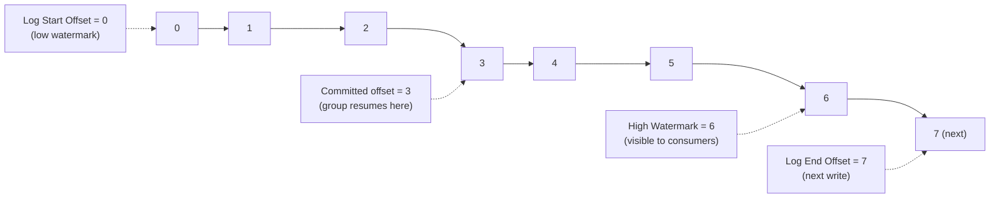

# 07 · Offsets (كل الأنواع)

> **Offset** = رقم تسلسلي (int64) لكل record داخل partition. ما بيتكرر، ما بيتغير، ما بيرجع يترقّم.



## القاموس
| Name | يعني | مين بيملكه |
|---|---|---|
| **Log Start Offset** (low) | أقدم record باقي (بعد retention) | broker |
| **Committed offset** | **الـ record الجاي** اللي الـ group رح يقرأه | `__consumer_offsets` |
| **Position** | وين الـ consumer واصل بالـ memory | consumer |
| **High Watermark (HW)** | آخر offset منسوخ على كل الـ ISR → مسموح يُقرأ | leader |
| **LEO** | الـ offset الجاي للكتابة | كل replica |
| **LSO** (tx) | آخر offset بدون transaction مفتوحة | leader |

## Commit = offset **+1**
```csharp
var r = consumer.Consume(ct);   // r.Offset = 41
consumer.Commit(r);             // commits 42 = "next to read"
```

## Consumer Lag
```text
lag = LEO(or HW) − committed
p0: 1000 − 950 = 50
p1: 1000 − 1000 = 0
total = 50
```
```bash
dotnet run --project examples/dotnet/12-LagMonitor -- demo-reader
```

## `auto.offset.reset` — لما ما في committed offset
| Value | يبدأ من |
|---|---|
| `latest` (default) | الرسائل الجديدة فقط |
| `earliest` | أقدم record موجود |
| `none` | exception |

## Gaps
- Compaction بيحذف records → offsets بتضل مع فجوات (`@0 @4 @9`)
- Transactions بتضيف control markers → offset مستهلك بدون record

## Key Points
- Offset per partition، مش per topic
- Committed = next، مش last
- Consumer يقدر يرجع لأي offset (seek)

Next → [08-record-anatomy.md](08-record-anatomy.md)
