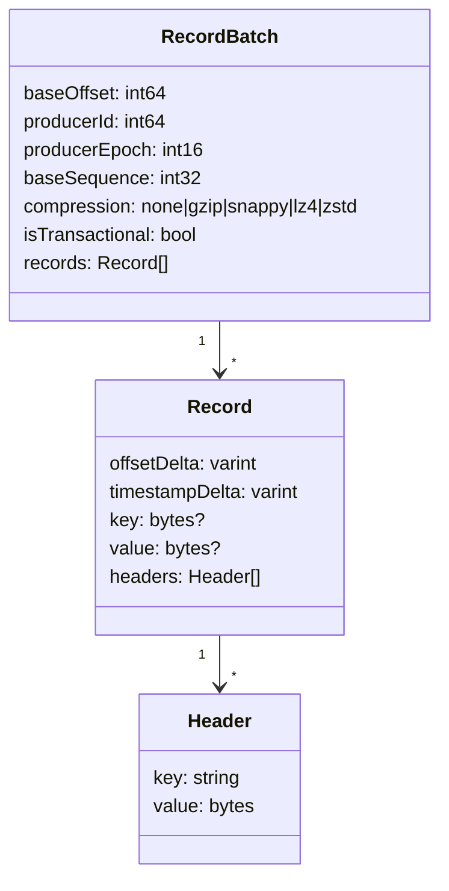

# 08 · Record Anatomy

> **Record** = key + value + headers + timestamp. على الشبكة والديسك الكل **bytes** — Kafka ما بتفهم JSON.



## كل field لشو؟
| Field | الاستخدام | مثال |
|---|---|---|
| **Key** | partitioning + compaction | `customer-42` |
| **Value** | الـ payload | `{"orderId":1001,...}` |
| **Headers** | metadata بدون فتح الـ payload | `event-type`, `correlation-id`, `traceparent` |
| **Timestamp** | CreateTime (producer) أو LogAppendTime (broker) | `1790771503023` |
| `null` value | **tombstone** (حذف key بـ compacted topic) | |

## Example (.NET)
```csharp
await producer.ProduceAsync("shop.order.created", new Message<string, string>
{
    Key = "customer-42",
    Value = JsonSerializer.Serialize(order),
    Headers = new Headers
    {
        { "event-type", "order.created.v1"u8.ToArray() },
        { "correlation-id", Encoding.UTF8.GetBytes(correlationId) }
    }
});
```

## Numbers: حجم الـ overhead
| | Bytes |
|---|---|
| Batch header | 61 |
| Record overhead (varints) | ~7-20 |
| Default max batch (`message.max.bytes`) | ~1 MB |
| 1 record 200B لحاله | ~280B |
| 100 records 200B بـ batch + lz4 | ~60-100B/record |

→ الـ batching + compression بيوفروا **3-5x** مساحة و bandwidth.

## Key Points
- Batch = وحدة الكتابة والضغط والنسخ
- Headers للـ routing/tracing، value للـ business
- رسالة > 1MB → claim-check (خزّن بـ S3، ابعت الرابط)

Next → [09-replication.md](../02-replication/09-replication.md)
