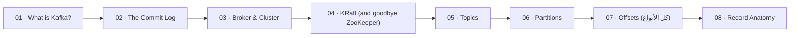

# 🧱 01 · Foundations — الأساسيات

> الـ log، الـ cluster، KRaft، topics، partitions، offsets

| # | Idea | One line |
|---|---|---|
| 01 | [What is Kafka?](01-what-is-kafka.md) | **Distributed commit log**: الـ events بتنكتب مرة وحدة وبتنقرأ من أي عدد consumers، بأي وقت، وبأي سرعة. |
| 02 | [The Commit Log](02-commit-log.md) | كل شي بـ Kafka مبني على فكرة وحدة: **ملف append-only** — كتابة بالآخر فقط، ولا تعديل. |
| 03 | [Broker & Cluster](03-broker-cluster.md) | **Broker** = سيرفر Kafka واحد (process). **Cluster** = مجموعة brokers بتتقاسم الـ partitions. |
| 04 | [KRaft (and goodbye ZooKeeper)](04-kraft.md) | الـ **metadata** (topics, partitions, leaders, configs, ACLs) صارت بـ Kafka نفسها عبر Raft. **Kafka 4.0 شالت ZooKeeper نهائياً.** |
| 05 | [Topics](05-topics.md) | **Topic** = اسم منطقي لـ stream من events من نفس النوع. فيزيائياً = مجموعة partitions. |
| 06 | [Partitions](06-partitions.md) | **Partition** = log مستقل (ملفات على ديسك broker). هي وحدة: **التوازي، الترتيب، التوزيع، والـ replication**. |
| 07 | [Offsets (كل الأنواع)](07-offsets.md) | **Offset** = رقم تسلسلي (int64) لكل record داخل partition. ما بيتكرر، ما بيتغير، ما بيرجع يترقّم. |
| 08 | [Record Anatomy](08-record-anatomy.md) | **Record** = key + value + headers + timestamp. على الشبكة والديسك الكل **bytes** — Kafka ما بتفهم JSON. |

[Map](../../README.md) · [Replication](../02-replication/README.md) →
