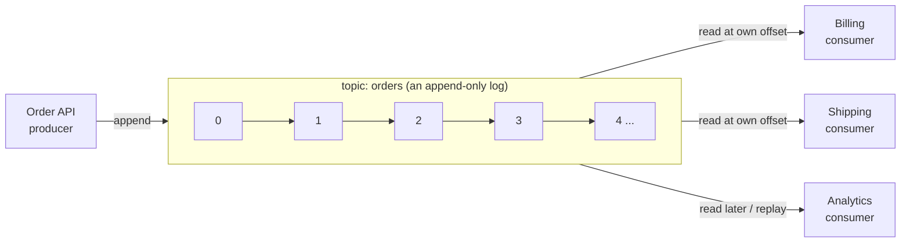

# 01 · What is Kafka

**Definition:** Apache Kafka is a distributed, replicated, append-only **log** of events that many applications write to and read from independently.

**Why it matters:** Services stop calling each other directly. A producer writes an event once; any number of consumers read it, now or later, at their own speed, and the event is still there after it is read.

## Key terms

| Term | One-line meaning |
|---|---|
| **Event / record** | A fact that happened: key, value, timestamp, headers |
| **Topic** | A named stream of events (like a table name for events) |
| **Partition** | One ordered, append-only file of a topic; the unit of scale |
| **Offset** | Position of a record inside a partition (0, 1, 2, …) |
| **Broker** | A Kafka server that stores partitions |
| **Producer** | Client that appends events |
| **Consumer** | Client that reads events and remembers its offset |

## Example

```
Initial data:
  cluster              : 3 brokers (localhost:9092, 9094, 9096)
  topic                : 01-hello (auto-created, 3 partitions)
  record               : key "greeting", value "Hello, Kafka!"

Commands:
  ProduceAsync(record) : stored at partition 2, offset 0
  Assign(p2, offset 0) : consumer points at that exact position
  Consume()            : key=greeting value=Hello, Kafka!

Result:
  record in the log    : still there after the read (reading never deletes)
  another reader       : can read offset 0 again at any time
```

## Diagram



Kafka vs a classic queue:

| | Classic queue (e.g. RabbitMQ queue) | Kafka topic |
|---|---|---|
| After a read | Message is removed | Record stays (until retention) |
| Many readers | Compete for messages | Each group reads everything |
| Replay | Not possible | Seek to any offset |
| Order | Per queue | Per partition |

## Code

[examples/01-hello-kafka/Program.cs](../examples/01-hello-kafka/Program.cs)

```csharp
using var producer = new ProducerBuilder<string, string>(new ProducerConfig { BootstrapServers = bootstrap }).Build();

// the topic is auto-created on first write (auto.create.topics.enable=true by default)
var delivered = await producer.ProduceAsync(topic, new Message<string, string> { Key = "greeting", Value = "Hello, Kafka!" });

using var consumer = new ConsumerBuilder<string, string>(consumerConfig).Build();

// read exactly the record we just wrote
consumer.Assign(delivered.TopicPartitionOffset);

var record = consumer.Consume(TimeSpan.FromSeconds(10));
```

Run: `docker compose up -d && cd examples/01-hello-kafka && dotnet run`

Output:

```text
Produced -> topic=01-hello partition=2 offset=0
Consumed <- topic=01-hello partition=2 offset=0 key=greeting value=Hello, Kafka!
```

## ✅ Correct vs ❌ wrong usage

| | Usage | Reason |
|---|---|---|
| ✅ | Publish "OrderPlaced" once; billing, shipping, analytics each consume it | One write, many independent readers |
| ✅ | Keep events for 7 days and replay after a bug fix | The log is durable and re-readable |
| ❌ | Use Kafka as a request/response RPC ("call and wait for answer") | Adds latency and complexity; use HTTP/gRPC |
| ❌ | Use Kafka as the primary database with ad-hoc queries | No indexes by value; read a projection into a DB instead |

## Pitfalls

1. Auto-created topics get broker defaults (partitions, replication) — create topics explicitly in production.
2. Reading does **not** delete; disk use is controlled by retention, not by consumers.
3. Order is guaranteed **per partition only**, not per topic.
4. Kafka stores bytes; the schema of the value is your responsibility (see [10](10-serialization-schema-registry.md)).

**Next:** [02 · Setup cluster](02-setup-cluster.md)
