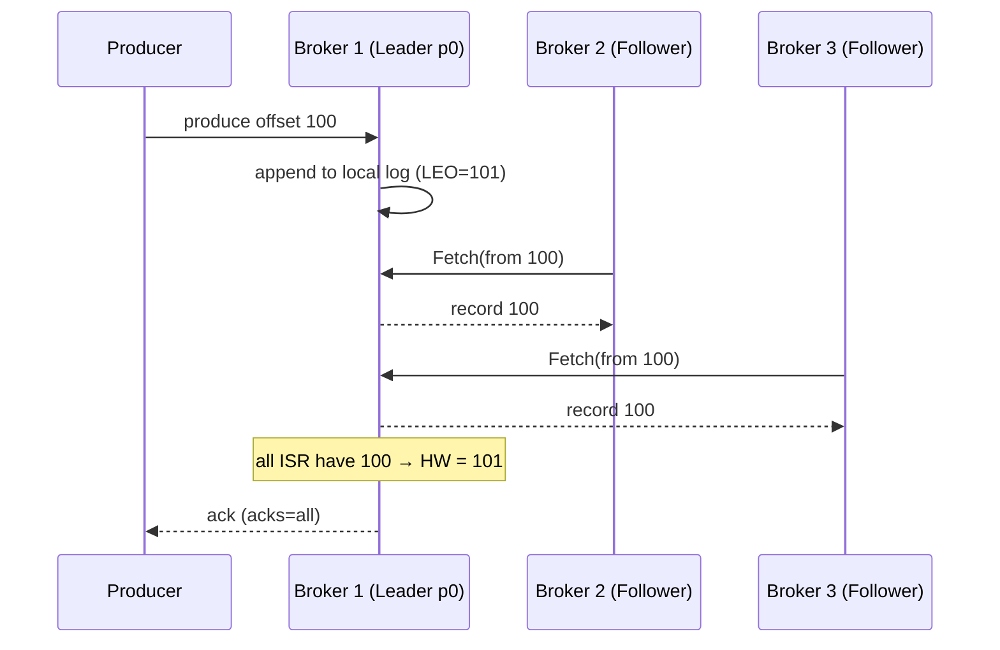
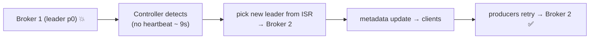

# 09 · Replication: Leader & Followers

> كل partition إلها **RF** نسخ على brokers مختلفين. نسخة وحدة **Leader** (كل الكتابة والقراءة)، والباقي **Followers** بيسحبوا منه.



## Followers = consumers عاديين
- بيعملوا `Fetch` من الـ leader (pull)
- ما بيخدموا clients (إلا مع `follower fetching` KIP-392 للـ rack-aware reads)

## Failover


## RF math
| RF | نسخ | تتحمل وقوع | Disk cost |
|---|---|---|---|
| 1 | 1 | 0 brokers ❌ | 1x |
| 2 | 2 | 1 (بس بدون أمان للكتابة) | 2x |
| **3** | 3 | **1 مع استمرار الكتابة** (min.isr=2) | 3x |
| 5 | 5 | 2 | 5x |

## Rack awareness
```properties
broker.rack=eu-west-1a    # كل broker بـ AZ مختلفة
```
→ الـ 3 replicas بيتوزعوا على 3 AZs → وقوع AZ كاملة ما بيضيّع داتا.

## جرّب: وقّف broker
```bash
docker stop kafka-1
dotnet run --project examples/dotnet/01-Admin   # leader moved, ISR shrank to 2,3
docker start kafka-1                            # rejoins ISR after catching up
```

## Key Points
- RF ≤ عدد الـ brokers
- Leader واحد per partition
- Replication = حماية، مش scaling للقراءة

Next → [10-isr-hw.md](10-isr-hw.md)
