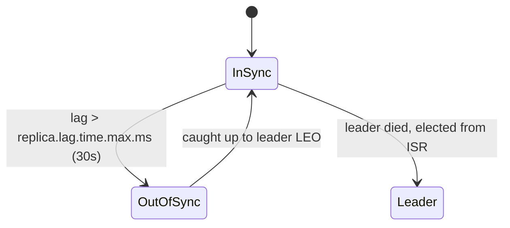
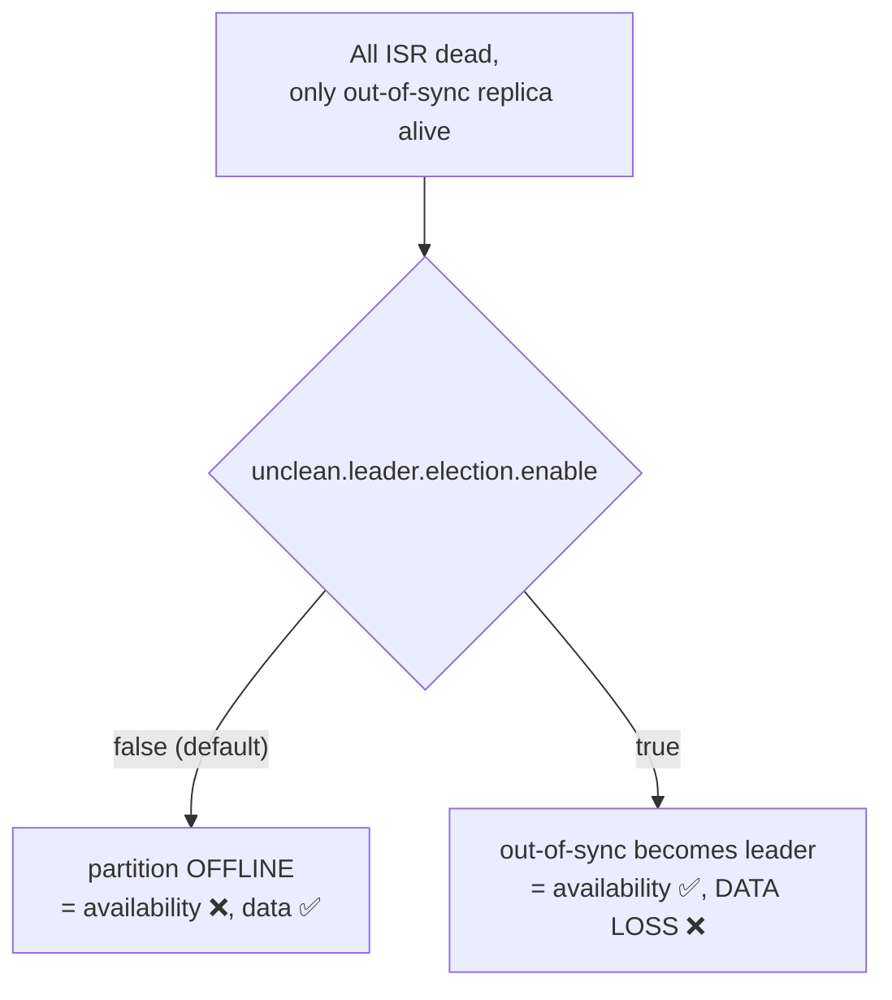

# 10 · ISR, High Watermark, min.insync.replicas

> **ISR** (In-Sync Replicas) = الـ replicas اللي لاحقين الـ leader. هم بس المرشحين يصيروا leader بدون فقدان داتا.



## High Watermark
```text
Leader   LEO=10  [0..9]
Follow1  LEO=10  [0..9]
Follow2  LEO=8   [0..7]      ← slow but still in ISR
HW = min(LEO of ISR) = 8  → consumers see 0..7 only
```
- ليش؟ لو الـ leader مات، الـ follower الجديد ممكن ما عنده 8,9 → لو قريناهم رح "يختفوا".

## `min.insync.replicas` × `acks=all`
| RF | min.isr | ISR الحالي | Write (acks=all) |
|---|---|---|---|
| 3 | 2 | 3 | ✅ |
| 3 | 2 | 2 (broker واقع) | ✅ |
| 3 | 2 | 1 | ❌ `NOT_ENOUGH_REPLICAS` |
| 3 | 1 | 1 | ✅ لكن نسخة وحدة = خطر |
| 3 | 3 | 2 | ❌ أي broker يوقع = توقف كتابة |

→ **RF=3 + min.isr=2** = المعادلة الذهبية.

## Unclean leader election


## .NET: ماذا ترى
```csharp
catch (ProduceException<string, string> e) when (e.Error.Code == ErrorCode.NotEnoughReplicas)
{
    // ISR < min.insync.replicas → retry later / return 503
}
```

## Metrics للمراقبة
| Metric | Alert |
|---|---|
| `UnderReplicatedPartitions` | > 0 لمدة 5 دقائق |
| `UnderMinIsrPartitionCount` | > 0 فوراً |
| `OfflinePartitionsCount` | > 0 فوراً 🚨 |

## Key Points
- ISR ديناميكية: بتصغر وبتكبر
- HW = حد القراءة
- min.isr بيطبق مع acks=all فقط

Next → [11-producer-internals.md](../03-producer/11-producer-internals.md)
