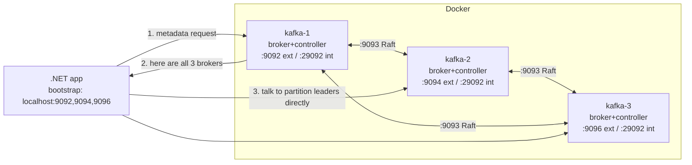

# 02 · Setup a 3-node KRaft cluster

**Definition:** A Kafka **cluster** is a set of brokers that share topics; in **KRaft** mode some nodes also act as **controllers** that store cluster metadata in a Raft log (no ZooKeeper).

**Why it matters:** One broker = no fault tolerance. Three nodes let every partition have 3 copies and keep working when one node dies.

## Example

Three nodes; every node is both **broker** (stores data) and **controller** (votes on metadata). Each partition has one copy per node (RF 3).

```
            kafka-1 :9092      kafka-2 :9094      kafka-3 :9096
            ┌───────────┐      ┌───────────┐      ┌───────────┐
 broker     │ p0 p1 p2  │      │ p0 p1 p2  │      │ p0 p1 p2  │   3 copies of each partition
 controller │   voter   │      │   voter   │      │   voter   │   majority = 2 of 3
            └───────────┘      └───────────┘      └───────────┘
```

| Nodes down | Copies left | Writes (`acks=all`, min ISR 2) | Metadata changes |
|---|---|---|---|
| 0 | 3 | ✅ | ✅ |
| 1 | 2 | ✅ | ✅ (2 of 3 voters) |
| 2 | 1 | ❌ NotEnoughReplicas (doc 12) | ❌ no majority |

## Diagram



Listeners used in [docker-compose.yml](../docker-compose.yml):

| Listener | Port | Who uses it |
|---|---|---|
| `EXTERNAL` | 9092 / 9094 / 9096 | Your C# app on the host (advertised as `localhost:<port>`) |
| `INTERNAL` | 29092 | Brokers replicating to each other, UI, Connect |
| `CONTROLLER` | 9093 | Raft quorum between controllers |

Cluster defaults set in compose: `num.partitions=3`, `default.replication.factor=3`, `min.insync.replicas=2`.

## Code

[examples/02-setup-cluster/Program.cs](../examples/02-setup-cluster/Program.cs)

```csharp
using var admin = new AdminClientBuilder(new AdminClientConfig { BootstrapServers = bootstrap }).Build();

var cluster = await admin.DescribeClusterAsync();

Console.WriteLine($"Controller : node {cluster.Controller?.Id}");

foreach (var node in cluster.Nodes.OrderBy(n => n.Id))
{
    Console.WriteLine($"Broker     : id={node.Id} address={node.Host}:{node.Port}");
}
```

```bash
docker compose up -d
docker compose ps
cd examples/02-setup-cluster && dotnet run
```

Output:

```text
Cluster id : MkU3OEVBNTcwNTJENDM2Qk
Controller : node 2
Broker     : id=1 address=localhost:9092
Broker     : id=2 address=localhost:9094
Broker     : id=3 address=localhost:9096
Topics     : 1 user, 1 internal
```

## ✅ Correct vs ❌ wrong usage

| | Usage | Reason |
|---|---|---|
| ✅ | `BootstrapServers = "localhost:9092,localhost:9094,localhost:9096"` | Client still starts if one broker is down |
| ✅ | Separate `INTERNAL` and `EXTERNAL` listeners | Containers and host reach brokers by different names |
| ❌ | Advertise `kafka-1:9092` to a host app | Host cannot resolve `kafka-1`; connection fails after bootstrap |
| ❌ | 2 controllers | Raft needs a majority; 2 nodes tolerate 0 failures, use 3 or 5 |

## Pitfalls

1. **Advertised listeners** are the #1 setup bug: the client connects to bootstrap, then to whatever address the broker *advertises*.
2. `CLUSTER_ID` must be identical on all nodes, and the storage must be formatted with it.
3. Combined mode (broker+controller in one process) is fine for dev; production usually runs dedicated controllers.
4. Give each broker enough heap/page cache; Kafka relies on the OS page cache, not the JVM heap.

**Next:** [03 · Topics, partitions, offsets](03-topics-partitions-offsets.md)
