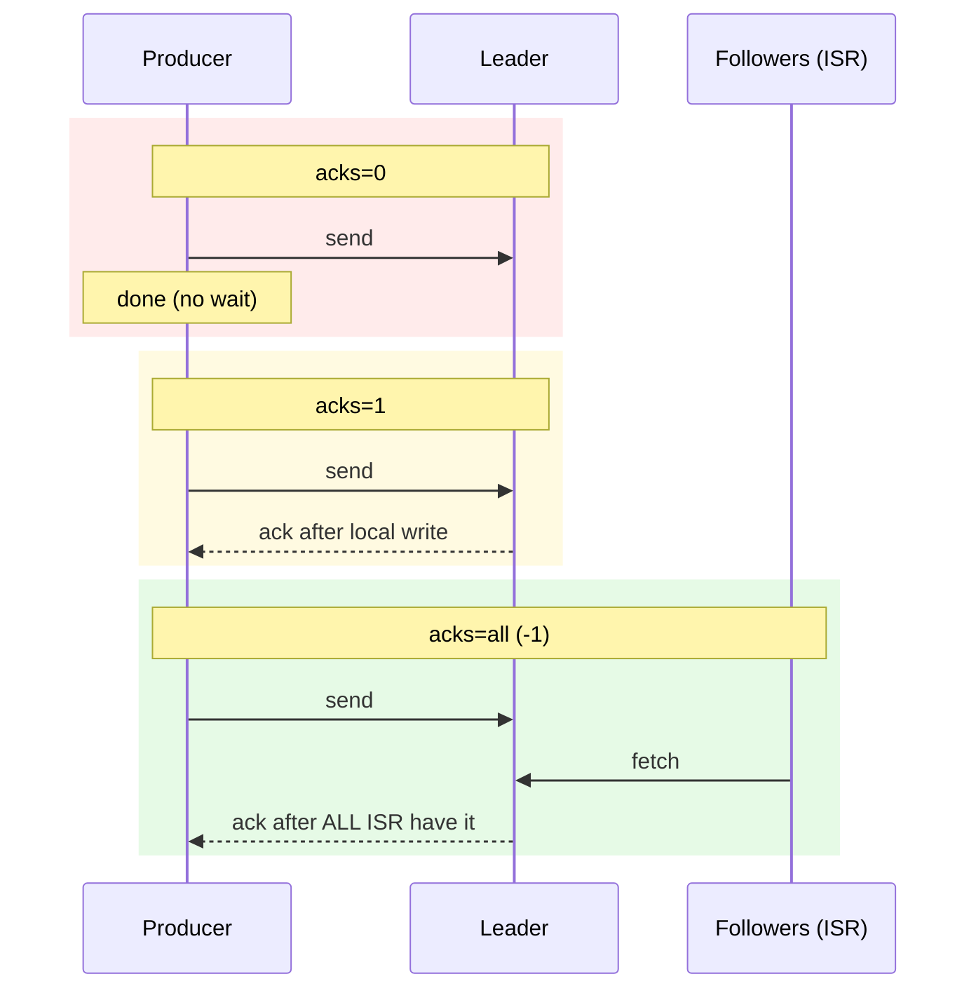
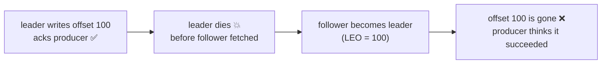

# 12 · acks & Durability

> `acks` = كم replica لازم تأكد الكتابة قبل ما الـ producer يعتبرها نجحت.



## المقارنة
| acks | Latency | Loss scenario | Use |
|---|---|---|---|
| `0` | ~0 | الـ broker ما استلم ولا تدري | metrics/logs غير مهمة |
| `1` | 1 write | leader استلم ومات قبل ما ينسخ | logs |
| `all` | ISR round-trip | فقط لو كل الـ ISR ماتوا | **orders, payments — default** |

## Loss scenario مع acks=1


## Durability recipe
```csharp
var config = new ProducerConfig
{
    Acks = Acks.All,
    EnableIdempotence = true,
};
// topic: replication.factor=3, min.insync.replicas=2
// broker: unclean.leader.election.enable=false
```

## Defaults
| Client | acks default | idempotence default |
|---|---|---|
| Java ≥ 3.0 | `all` | `true` |
| librdkafka / .NET | `all` | **`false`** ← فعّلها يدوياً |

## Key Points
- acks=all بدون min.isr=2 = ضعيف
- "ack" = replicated بالـ memory/page cache، مش fsync
- Kafka تعتمد على replication مش fsync

Next → [13-idempotent-producer.md](13-idempotent-producer.md)
