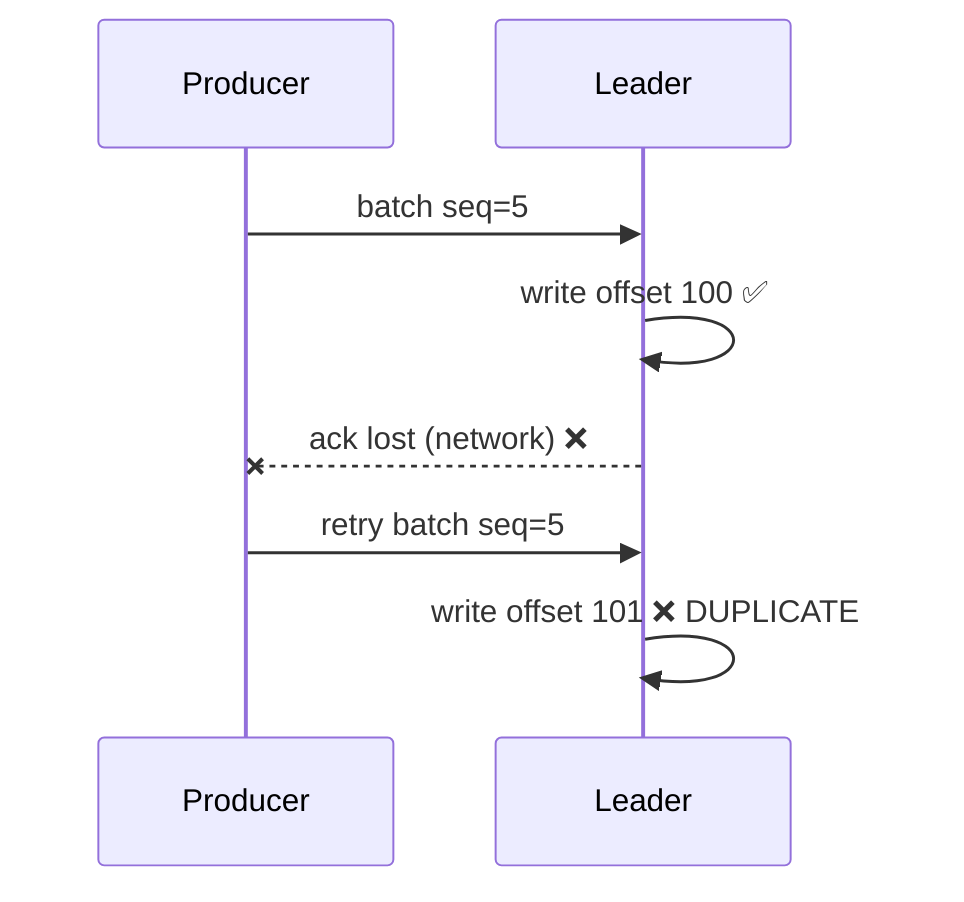
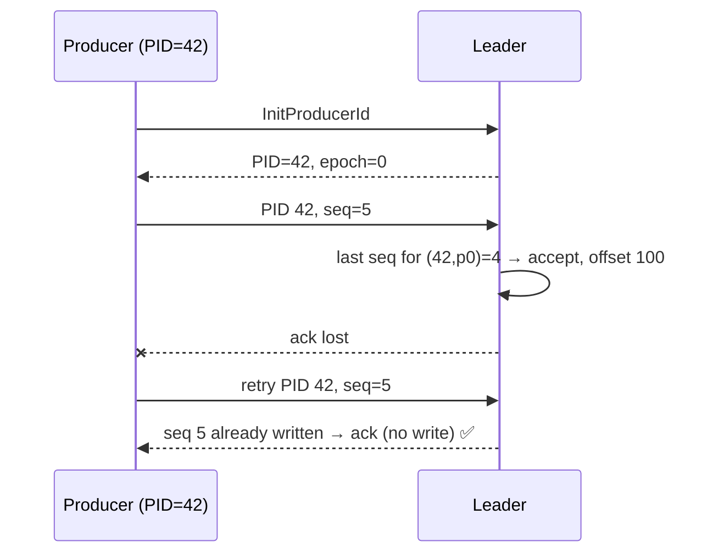

# 13 · Idempotent Producer

> الـ retries ممكن تكتب نفس الرسالة مرتين. **Idempotence** = الـ broker بيكشف التكرار ويرفضه عبر `(ProducerId, Sequence)`.

## المشكلة


## الحل


## Broker rules per (PID, partition)
| Incoming seq | Broker action |
|---|---|
| last + 1 | ✅ write |
| ≤ last | duplicate → ack بدون كتابة |
| > last + 1 | `OutOfOrderSequence` (gap) |

## Config
```csharp
new ProducerConfig
{
    EnableIdempotence = true,  // forces: acks=all, retries=∞, max.in.flight ≤ 5
    MaxInFlight = 5            // up to 5 batches in flight, still ordered
};
```

## Scope (مهم للمقابلات)
| يحمي من | ما يحمي من |
|---|---|
| retry داخل نفس الـ producer session | restart للـ app (PID جديد) |
| duplicates per partition | app يستدعي `Produce` مرتين لنفس الـ business event |
| reordering بسبب retries | duplicates بالـ consumer side |

→ للـ restarts: `TransactionalId` ثابت ([20](../05-delivery-semantics/20-transactions-eos.md)). للـ business: `EventId` + idempotent consumer ([19](../05-delivery-semantics/19-delivery-semantics.md)).

## Key Points
- مجاني تقريباً: فعّله دائماً
- Exactly-once **per partition, per session**
- `max.in.flight > 5` + idempotence = error

Next → [14-partitioning-keys.md](14-partitioning-keys.md)
