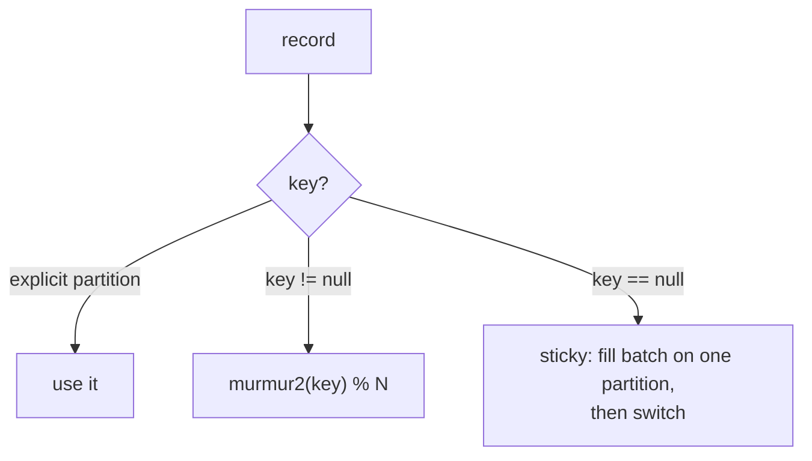

# 14 · Partitioning & Keys

> `partition = hash(key) % numPartitions`. نفس الـ key ⇒ نفس الـ partition ⇒ **ترتيب مضمون لهاد الـ key**.



## Output حقيقي (examples/05)
```text
alice  → p3 @0
bob    → p0 @0
alice  → p3 @1      ← same partition, offset++
alice  → p3 @2
```

## ⚠ .NET gotcha: الـ partitioner مختلف!
```text
alice  murmur2=p3  crc32=p5  ⚠ different!
bob    murmur2=p0  crc32=p2  ⚠ different!
carol  murmur2=p2  crc32=p5  ⚠ different!
```
| Client | Default partitioner |
|---|---|
| Java / Spring | murmur2 |
| **librdkafka (.NET, Go, Python)** | **`consistent_random` (CRC32)** |

```csharp
Partitioner = Partitioner.Murmur2Random   // ✅ نفس Java → Java و .NET بيكتبوا نفس key لنفس partition
```

## اختيار الـ key
| Use case | Key | ليش |
|---|---|---|
| Orders lifecycle | `orderId` | created → paid → shipped بالترتيب |
| Bank account | `accountId` | deposits/withdrawals بالترتيب |
| Clicks analytics | `null` | ما في ترتيب مطلوب → توزيع متساوي |
| CDC من DB | primary key | آخر حالة للصف |

## Hot partition
```text
key = country, 70% traffic = "JO"
p0 (JO): 70,000 msg/s  🔥  ← consumer واحد مخنوق
p1..p5 : 6,000 msg/s each
```
✅ Fix: key أدق (`country:userId`) أو salting (`JO-{hash%4}`) — مع خسارة الترتيب الكلي.

## Key Points
- Key = ordering + distribution
- زيادة partitions = key mapping يتغير
- Key فيه cardinality عالية ⇒ توزيع أحسن

Next → [15-consumer-poll-loop.md](../04-consumer/15-consumer-poll-loop.md)
