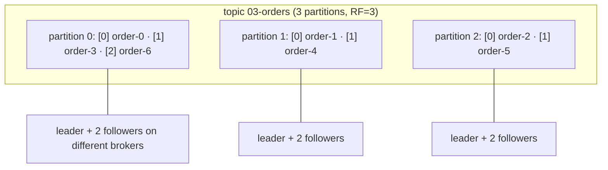
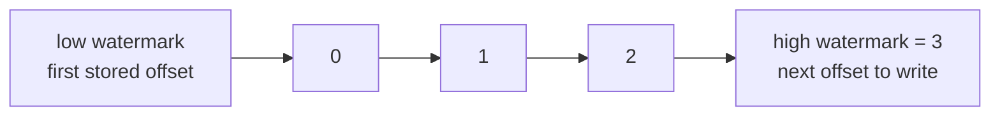

# 03 · Topics, partitions, offsets

**Definition:** A **topic** is split into **partitions**; each partition is an ordered log where every record gets a sequential **offset**.

**Why it matters:** Partitions are how Kafka scales (spread over brokers, read in parallel) and offsets are how every consumer knows exactly where it is.

## Example

An event's address is **(topic, partition, offset)**. Offsets count per partition, so offset 1 exists three times.

```
topic 03-orders (7 events, partition = i % 3)

               offset 0    offset 1    offset 2     high watermark
p0 (leader 3) │ order-0  │ order-3  │ order-6  │    3
p1 (leader 1) │ order-1  │ order-4  │               2
p2 (leader 2) │ order-2  │ order-5  │               2
                                                   ─────
                                                     7 events

order-4 = (03-orders, p1, offset 1)
```

## Diagram



Watermarks of one partition:



## Code

[examples/03-topics-partitions-offsets/Program.cs](../examples/03-topics-partitions-offsets/Program.cs)

```csharp
await admin.CreateTopicsAsync([new TopicSpecification { Name = topic, NumPartitions = 3, ReplicationFactor = 3 }]);

for (var i = 0; i < 7; i++)
{
    var partition = new TopicPartition(topic, new Partition(i % 3));

    var result = await producer.ProduceAsync(partition, new Message<Null, string> { Value = $"order-{i}" });
}

// low = first offset still stored, high = next offset to be written
var marks = consumer.QueryWatermarkOffsets(new TopicPartition(topic, p), TimeSpan.FromSeconds(5));
```

Output:

```text
order-0 -> partition 0, offset 0
order-1 -> partition 1, offset 0
order-2 -> partition 2, offset 0
order-3 -> partition 0, offset 1
order-4 -> partition 1, offset 1
order-5 -> partition 2, offset 1
order-6 -> partition 0, offset 2

partition 0: low=0 high=3 -> 3 events
partition 1: low=0 high=2 -> 2 events
partition 2: low=0 high=2 -> 2 events

partition 0: leader=3 replicas=[3,1,2] isr=[3,1,2]
partition 1: leader=1 replicas=[1,2,3] isr=[1,2,3]
partition 2: leader=2 replicas=[2,3,1] isr=[2,3,1]
```

## ✅ Correct vs ❌ wrong usage

| | Usage | Reason |
|---|---|---|
| ✅ | Pick partitions = max consumers you expect in one group (e.g. 6, 12) | One partition is read by at most one consumer of a group |
| ✅ | Create topics with explicit partitions and RF | Predictable layout and durability |
| ❌ | 1 partition for a high-volume topic | Only one consumer can read it; no parallelism |
| ❌ | 10,000 partitions "just in case" | More files, slower failover, more memory per client |
| ❌ | Assume offsets are global across the topic | Offsets restart at 0 **per partition** |

## Pitfalls

1. You can **add** partitions later but never remove them, and adding them changes key→partition mapping.
2. Offsets are per partition; "offset 1" exists in every partition.
3. Offsets are not guaranteed contiguous for consumers (transactions and compaction leave gaps).
4. Topic names: `.` and `_` collide in metric names; pick one style.

**Next:** [04 · Producer](04-producer.md)
