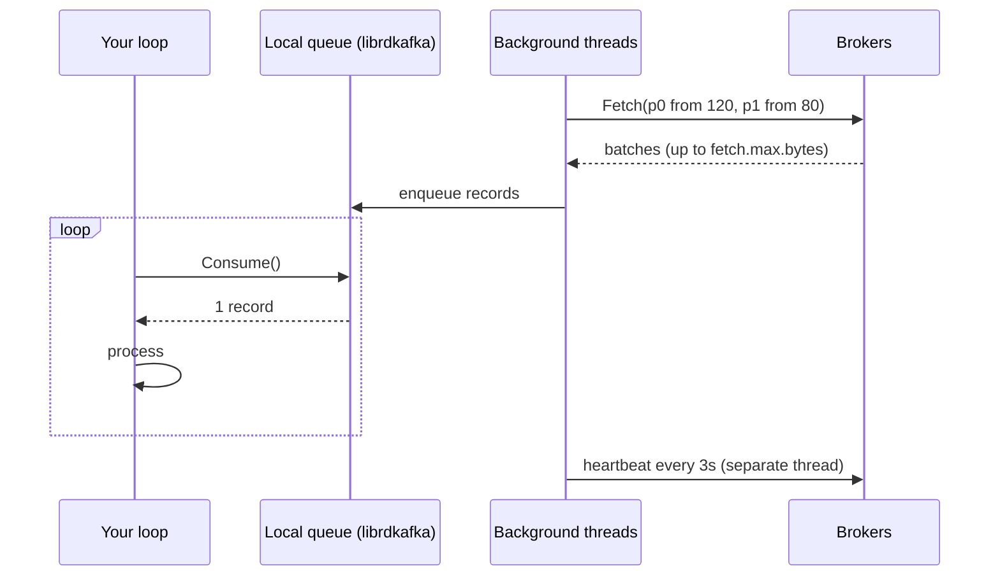
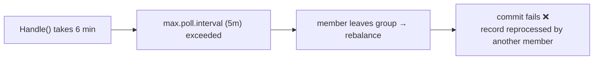

# 15 · Consumer Poll Loop

> الـ consumer بيسحب (pull) batches بالخلفية، و `Consume()` بيعطيك record وحدة من الـ buffer المحلي.



## The loop
```csharp
consumer.Subscribe("shop.order.created");
try
{
    while (true)
    {
        var r = consumer.Consume(ct);          // blocks until a record or cancel
        Handle(r.Message);
        consumer.Commit(r);                    // or StoreOffset + auto commit
    }
}
catch (OperationCanceledException) { }
finally { consumer.Close(); }                  // leave group cleanly
```

## الـ timeouts الثلاثة
| Config | Default | لو انتهى |
|---|---|---|
| `heartbeat.interval.ms` | 3s | — (نبض) |
| `session.timeout.ms` | 45s | ما في heartbeat → member ميت → rebalance |
| `max.poll.interval.ms` | 5 min | ما استدعيت `Consume()` → member بيطلع من الـ group |



## Fetch tuning
| Config | Default | أثر |
|---|---|---|
| `fetch.min.bytes` | 1 | ارفعه → batches أكبر، latency أعلى |
| `fetch.wait.max.ms` | 500 | أقصى انتظار لـ fetch.min.bytes |
| `max.partition.fetch.bytes` | 1 MB | per partition |

## .NET: `Consume()` blocking
```csharp
// BackgroundService: شغّل الـ loop على thread خاص
protected override Task ExecuteAsync(CancellationToken ct)
    => Task.Run(() => Loop(ct), ct);
```

## Key Points
- Consumer **مش thread-safe** → واحد per thread
- Processing طويل ⇒ ارفع `max.poll.interval.ms`
- دايماً `Close()`

## Pitfall (شفناه فعلياً بـ examples/07)
❌ consumer مات بدون `Close()` → الـ partitions **محجوزة 45s** → ✅ `Close()` + `session.timeout.ms` مناسب.

Next → [16-consumer-groups.md](16-consumer-groups.md)
