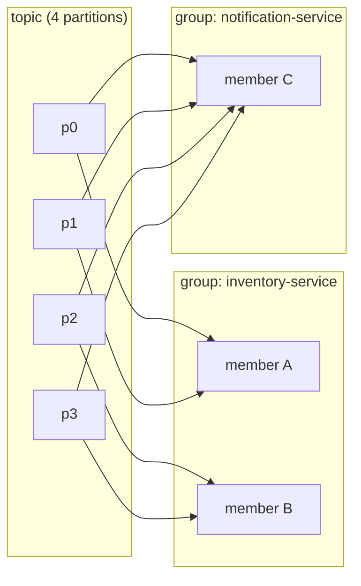
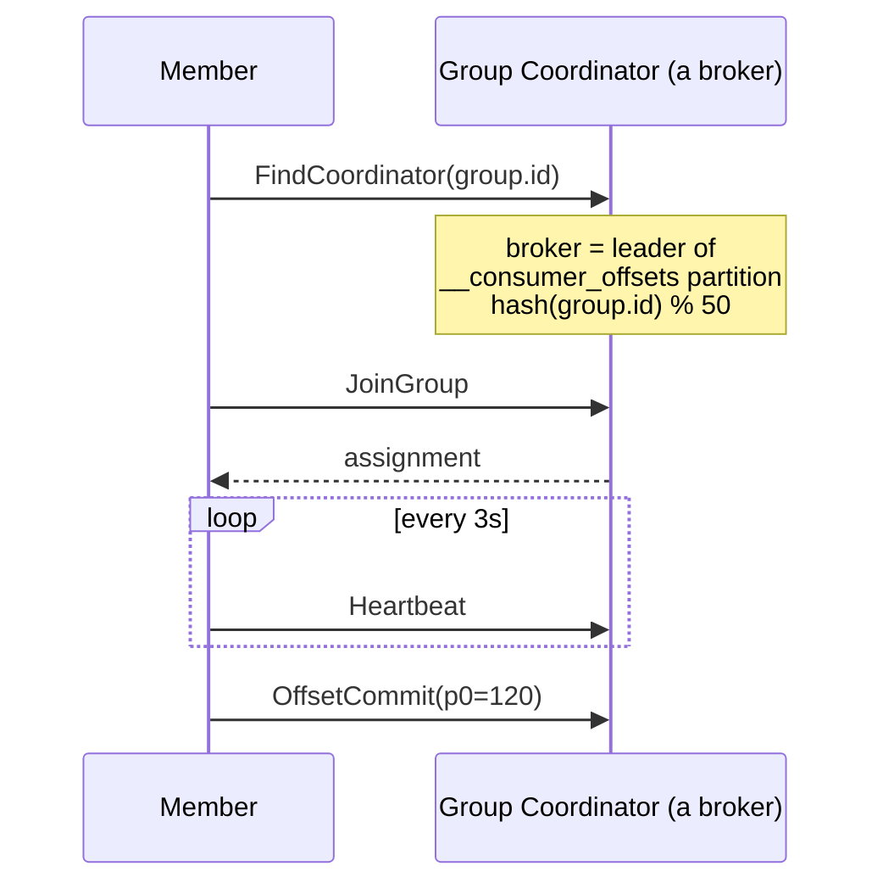

# 16 · Consumer Groups

> **Group** = consumers بنفس `group.id` بيتقاسموا الـ partitions. كل partition ⇒ **member واحد بس** داخل الـ group.



## قاعدتين بس
| Rule | النتيجة |
|---|---|
| **داخل** group: partition → member واحد | load balancing (queue semantics) |
| **بين** groups: كل group ياخد كل شي | fan-out (pub/sub semantics) |

## Members vs Partitions (6 partitions)
| Members | Distribution | Note |
|---|---|---|
| 1 | 6 | |
| 2 | 3 / 3 | |
| 3 | 2 / 2 / 2 | |
| 4 | 2 / 2 / 1 / 1 | |
| 6 | 1 × 6 | max parallelism |
| 8 | 1 × 6 + **2 idle** | ❌ هدر |

## Group Coordinator


## جرّب (3 terminals)
```bash
dotnet run --project examples/dotnet/04-ConsumerGroup -- A
dotnet run --project examples/dotnet/04-ConsumerGroup -- B
dotnet run --project examples/dotnet/04-ConsumerGroup -- C
```
Output حقيقي (A أول، بعد 12s دخل B):
```text
[A] ➕ assigned 0,1,2,3,4,5   → now owns: [0,1,2,3,4,5]
[A] ➖ revoked 0,1,2          → now owns: [3,4,5]     ← 3,4,5 ما وقفوا (cooperative)
[B] ➕ assigned 2,1,0         → now owns: [0,1,2]
```

## Key Points
- group.id = هوية الـ service
- Scaling = زيد members لحد عدد partitions
- Offsets محفوظة per group

Next → [17-rebalancing.md](17-rebalancing.md)
