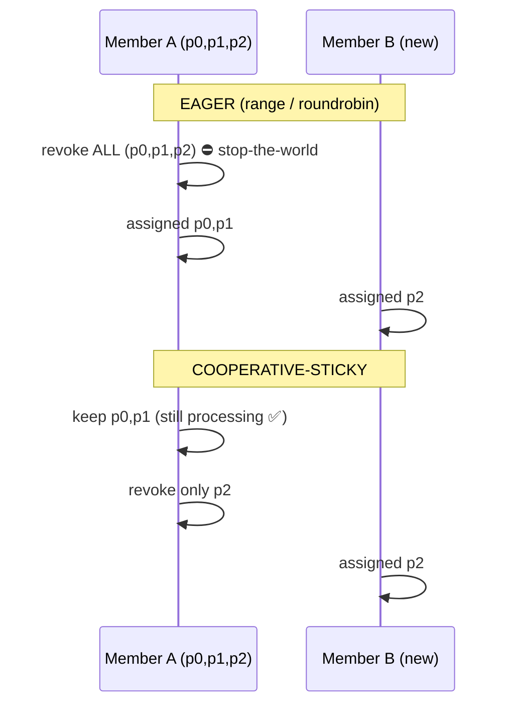
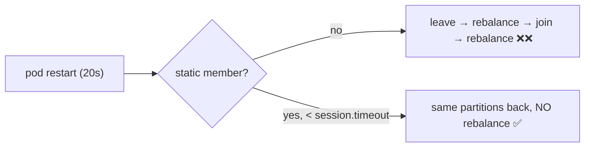

# 17 · Rebalancing

> **Rebalance** = إعادة توزيع الـ partitions لما member يدخل/يطلع/يموت أو تتغير الـ partitions. خلاله، الـ partitions المنقولة **ما بتنقرأ**.

## Triggers
| Event | مثال |
|---|---|
| Member joins | deploy / scale out |
| Member leaves | `Close()` |
| Member dies | no heartbeat > `session.timeout.ms` |
| Member stuck | no poll > `max.poll.interval.ms` |
| Partitions added | `--alter --partitions` |

## Eager vs Cooperative


| Strategy | Stop-the-world | Moves |
|---|---|---|
| `range` (Java default قديماً) | ✅ | كثير |
| `roundrobin` | ✅ | كثير |
| `cooperative-sticky` | ❌ incremental | أقل ما يمكن |

```csharp
PartitionAssignmentStrategy = PartitionAssignmentStrategy.CooperativeSticky
```

## Static membership
```csharp
GroupInstanceId = "inventory-pod-1"   // stable per pod (StatefulSet name)
```


## KIP-848: الـ protocol الجديد (Kafka 4.0 GA)
| | Classic | New (`group.protocol=consumer`) |
|---|---|---|
| مين بيحسب التوزيع | الـ client leader | **الـ broker** |
| Global sync barrier | ✅ | ❌ |
| Rebalance time (big groups) | ثواني → دقائق | **ms → ثواني** |

```csharp
config.Set("group.protocol", "consumer");   // librdkafka ≥ 2.10 + broker ≥ 4.0
```

## Revoked handler = آخر فرصة
```csharp
.SetPartitionsRevokedHandler((c, parts) =>
{
    FlushInFlightWork(parts);
    c.Commit(parts.Select(p => new TopicPartitionOffset(p.TopicPartition, NextOffset(p))));
})
```

## Key Points
- Rebalance = إيقاف جزئي أو كلي
- cooperative-sticky + static = أقل ألم
- Deploys rolling ⇒ rebalances كثير

Next → [18-offset-commit.md](18-offset-commit.md)
