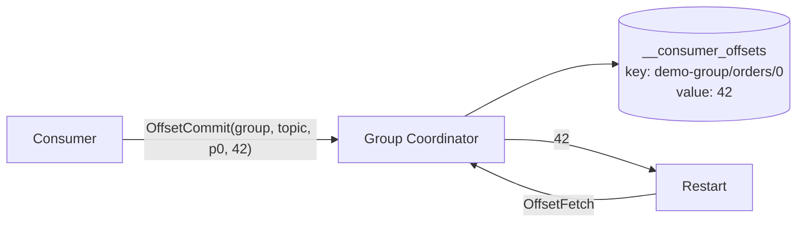
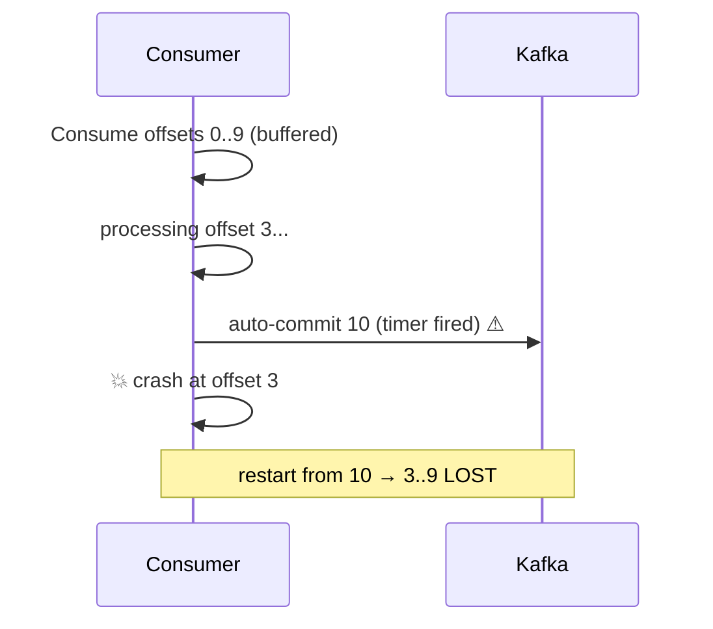

# 18 · Offset Commit Strategies

> الـ commit = "وصلت لهون". بينحفظ بـ topic داخلي **`__consumer_offsets`** (50 partitions, compacted) بـ key = `(group, topic, partition)`.



## 4 استراتيجيات
| Strategy | Config | Semantics | Throughput |
|---|---|---|---|
| Auto commit | `EnableAutoCommit=true` | ⚠ ممكن commit قبل ما تخلص | ⭐⭐⭐ |
| Auto + StoreOffset | auto + `EnableAutoOffsetStore=false` | at-least-once ✅ | ⭐⭐⭐ |
| Manual sync per record | `Commit(r)` | at-least-once ✅ | ⭐ |
| Manual per batch | `Commit()` كل N | at-least-once ✅ | ⭐⭐ |

## ✅ Recommended (.NET): StoreOffset
```csharp
var config = new ConsumerConfig
{
    EnableAutoCommit = true,          // background commit every 5s
    EnableAutoOffsetStore = false     // but only commit what I stored
};

while (true)
{
    var r = consumer.Consume(ct);
    Handle(r);                        // 1) process
    consumer.StoreOffset(r);          // 2) mark done → committed within 5s
}
```

## Auto commit trap

> librdkafka بـ default `EnableAutoOffsetStore=true` بيخزن الـ offset لما `Consume()` يرجع الـ record — قبل ما تعالجه.

## Commit per record = بطيء — قياس حقيقي (examples/13, نفس الجهاز)
| Strategy | Processed |
|---|---|
| `consumer.Commit(r)` sync لكل record | **28** records بـ 15s |
| `StoreOffset(r)` + auto commit 5s | **5,174** records بـ ~18s |

→ كل `Commit()` = round-trip متزامن للـ coordinator. StoreOffset = memory فقط، والـ commit بالخلفية.

## Reset offsets (CLI)
```bash
kafka-consumer-groups.sh --bootstrap-server localhost:19092 --group demo-reader \
  --reset-offsets --to-datetime 2026-09-30T10:00:00.000 --topic demo.orders --execute
# also: --to-earliest | --to-latest | --shift-by -100 | --to-offset 42
```
> لازم الـ group يكون **فاضي** (كل الـ members موقفين).

## Key Points
- Commit بعد المعالجة، دايماً
- الـ offsets بتنتهي: `offsets.retention.minutes` = 7 أيام بعد ما الـ group يفضى
- Commit ≠ حذف الرسالة

Next → [19-delivery-semantics.md](../05-delivery-semantics/19-delivery-semantics.md)
