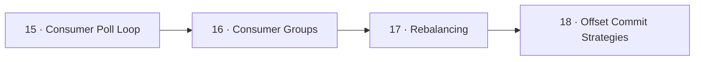

# 📥 04 · Consumer — الـ Consumer

> poll loop، consumer groups، rebalancing، offset commits

| # | Idea | One line |
|---|---|---|
| 15 | [Consumer Poll Loop](15-consumer-poll-loop.md) | الـ consumer بيسحب (pull) batches بالخلفية، و `Consume()` بيعطيك record وحدة من الـ buffer المحلي. |
| 16 | [Consumer Groups](16-consumer-groups.md) | **Group** = consumers بنفس `group.id` بيتقاسموا الـ partitions. كل partition ⇒ **member واحد بس** داخل الـ group. |
| 17 | [Rebalancing](17-rebalancing.md) | **Rebalance** = إعادة توزيع الـ partitions لما member يدخل/يطلع/يموت أو تتغير الـ partitions. خلاله، الـ partitions المنقولة **ما بتنقرأ**. |
| 18 | [Offset Commit Strategies](18-offset-commit.md) | الـ commit = "وصلت لهون". بينحفظ بـ topic داخلي **`__consumer_offsets`** (50 partitions, compacted) بـ key = `(group, topic, partition)`. |

← [Producer](../03-producer/README.md) · [Map](../../README.md) · [Delivery Semantics](../05-delivery-semantics/README.md) →
