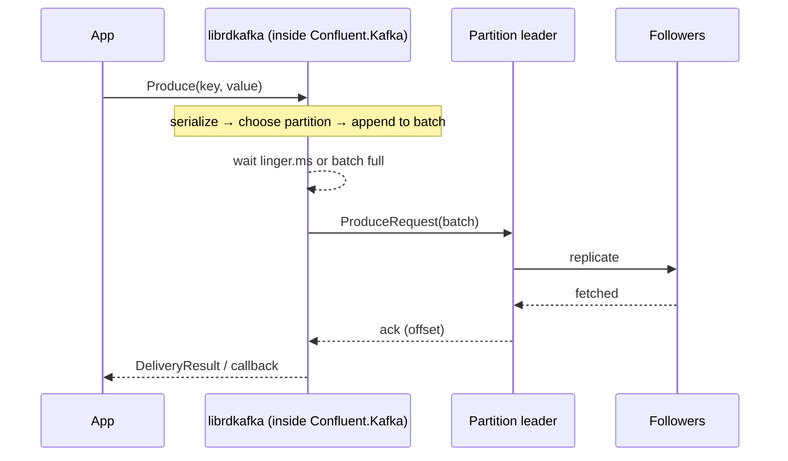

# 04 · Producer

**Definition:** A **producer** serializes records, picks a partition, batches records per partition, and sends batches to the partition leaders.

**Why it matters:** How you send (await each vs fire-with-callback, batching, flush) decides throughput and whether messages are lost on shutdown.

## Example

```
Initial data:
  topic                : 04-payments (3 partitions)
  config               : acks=all, enable.idempotence=true, linger.ms=5

Commands:
  ProduceAsync(pay-1001)    : partition 2, offset 2, status Persisted
  Produce ×5 + callback     : pay-2001 p2@3 · pay-2002..2004 p0@3..5 · pay-2005 p1@1
  Flush(10 s)               : stillQueued = 0

Result:
  delivered                 : 1 awaited + 5 callbacks = 6 records
  same partition, new key   : offsets keep growing (p0: 3 → 4 → 5)
```

## Diagram



Key producer settings:

| Setting | Default (librdkafka) | Effect |
|---|---|---|
| `acks` | `all` | How many replicas must have the batch before ack |
| `enable.idempotence` | `false` | No duplicates on retry (see [08](08-delivery-semantics.md)) |
| `linger.ms` | `5` | Wait to fill bigger batches |
| `batch.size` | `1000000` | Max bytes per partition batch |
| `compression.type` | `none` | `lz4`/`zstd` shrink batches |
| `message.timeout.ms` | `300000` | Give up delivering after this |

## Code

[examples/04-producer/Program.cs](../examples/04-producer/Program.cs)

```csharp
// style 1: await each send (simple, slower: one round trip per message)
var result = await producer.ProduceAsync(topic, message);

// style 2: Produce + delivery callback (fast: many messages in flight, batched)
producer.Produce(topic, new Message<string, string> { Key = $"pay-200{i}", Value = ... }, report =>
{
    Console.WriteLine($"[callback] key={report.Message.Key} -> p{report.Partition.Value}@{report.Offset.Value} error={report.Error.Code}");
});

// Produce() only queues; Flush waits until every queued message is acknowledged
var stillQueued = producer.Flush(TimeSpan.FromSeconds(10));
```

Output:

```text
[await]    key=pay-1001 -> p2@2 status=Persisted ts=2026-11-01T15:05:29.2290000Z
[callback] key=pay-2001 -> p2@3 error=NoError
[callback] key=pay-2002 -> p0@3 error=NoError
[callback] key=pay-2003 -> p0@4 error=NoError
[callback] key=pay-2004 -> p0@5 error=NoError
[callback] key=pay-2005 -> p1@1 error=NoError
delivered=5 stillQueued=0
```

## ✅ Correct vs ❌ wrong usage

| | Usage | Reason |
|---|---|---|
| ✅ | One long-lived `IProducer` per app (singleton in DI) | It is thread-safe; holds connections and batches |
| ✅ | `Produce` + callback for high volume, `ProduceAsync` for simple request flows | Throughput vs simplicity |
| ✅ | `Flush` before the process exits | Queued messages are otherwise lost |
| ❌ | `new ProducerBuilder(...).Build()` per HTTP request | New TCP connections + metadata every time; very slow |
| ❌ | `ProduceAsync(...).Result` in a loop | Blocks threads and serializes all sends |

## Pitfalls

1. `Produce()` returning means *queued*, not *stored*. Check the delivery report.
2. Forgetting `Flush`/`Dispose` loses the last batch on shutdown.
3. Large messages (> 1 MB default `message.max.bytes`) are rejected; store blobs elsewhere and send a reference.
4. Headers are bytes; agree on encoding (UTF-8).
5. `ProduceAsync` throws `ProduceException`; `Produce` reports errors only in the callback.

**Next:** [05 · Consumer](05-consumer.md)
