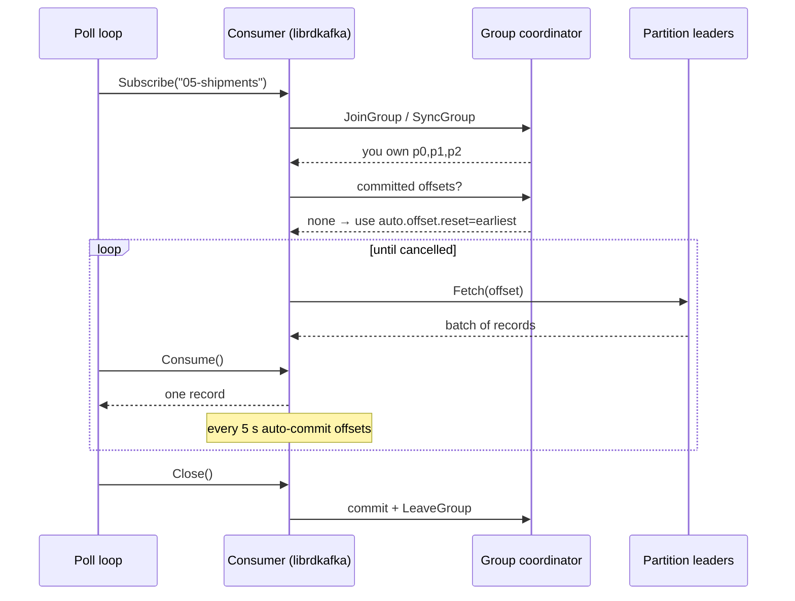

# 05 · Consumer

**Definition:** A **consumer** subscribes to topics, fetches batches from partition leaders, hands records to your code one by one, and commits the offset it has processed.

**Why it matters:** The poll loop, `auto.offset.reset` and a clean `Close()` decide whether you skip data, re-read data, or stall your group.

## Example

A consumer keeps one **cursor per partition**. With no committed offset, `auto.offset.reset=earliest` starts every cursor at 0.

| Partition | Records | Cursor before | Read | Committed on `Close()` |
|---|---|---|---|---|
| p0 | ship-6 | none → 0 | 1 | 1 |
| p1 | ship-3, ship-4, ship-5 | none → 0 | 3 | 3 |
| p2 | ship-1, ship-2 | none → 0 | 2 | 2 |

Actual read order: `ship-6 → ship-1, ship-2 → ship-3, ship-4, ship-5`. Order is kept inside a partition, not across partitions.

## Diagram



| Setting | Default | Meaning |
|---|---|---|
| `group.id` | (required for Subscribe) | Consumers with the same id share the work |
| `auto.offset.reset` | `latest` | Where to start when the group has **no** committed offset |
| `enable.auto.commit` | `true` | Commit in background every `auto.commit.interval.ms` (5000) |
| `max.poll.interval.ms` | `300000` | Max time between `Consume()` calls before you are kicked out |
| `session.timeout.ms` | `45000` | Heartbeat silence before the group considers you dead |

## Code

[examples/05-consumer/Program.cs](../examples/05-consumer/Program.cs)

```csharp
using var consumer = new ConsumerBuilder<string, string>(config).Build();

consumer.Subscribe(topic);

try
{
    while (count < 6)
    {
        // blocks until a record arrives or the token is cancelled
        var record = consumer.Consume(cts.Token);

        count++;
    }
}
catch (OperationCanceledException) { }
finally
{
    // leaves the group cleanly and commits the final offsets
    consumer.Close();
}
```

Output:

```text
p0@0 key=ship-6 value="parcel 6 left warehouse"
p2@0 key=ship-1 value="parcel 1 left warehouse"
p2@1 key=ship-2 value="parcel 2 left warehouse"
p1@0 key=ship-3 value="parcel 3 left warehouse"
p1@1 key=ship-4 value="parcel 4 left warehouse"
p1@2 key=ship-5 value="parcel 5 left warehouse"
consumed 6 records
```

Records come **ordered inside each partition**, but partitions are interleaved.

## ✅ Correct vs ❌ wrong usage

| | Usage | Reason |
|---|---|---|
| ✅ | `Close()` in `finally` | Fast rebalance for the rest of the group, final commit |
| ✅ | Run the loop in a `BackgroundService` on its own thread | `Consume` blocks |
| ✅ | `AutoOffsetReset = Earliest` for a new service that must see history | Default `latest` silently skips existing data |
| ❌ | Slow work (> `max.poll.interval.ms`) between `Consume()` calls | Consumer is kicked out, partitions rebalance, records are re-delivered |
| ❌ | Sharing one consumer instance across threads | `IConsumer` is **not** thread-safe |

## Pitfalls

1. `auto.offset.reset` only applies when there is **no committed offset**; changing it later does nothing for an existing group.
2. Auto-commit may commit records your code has not finished → possible loss on crash (see [09](09-offset-commits.md)).
3. `Consume(timeout)` returns `null` on timeout — check it.
4. Deserialization errors throw `ConsumeException` and the record is skipped only if you seek past it.
5. Forgetting `Close()` → the group waits `session.timeout.ms` before reassigning your partitions.

**Next:** [06 · Consumer groups & rebalancing](06-consumer-groups.md)
