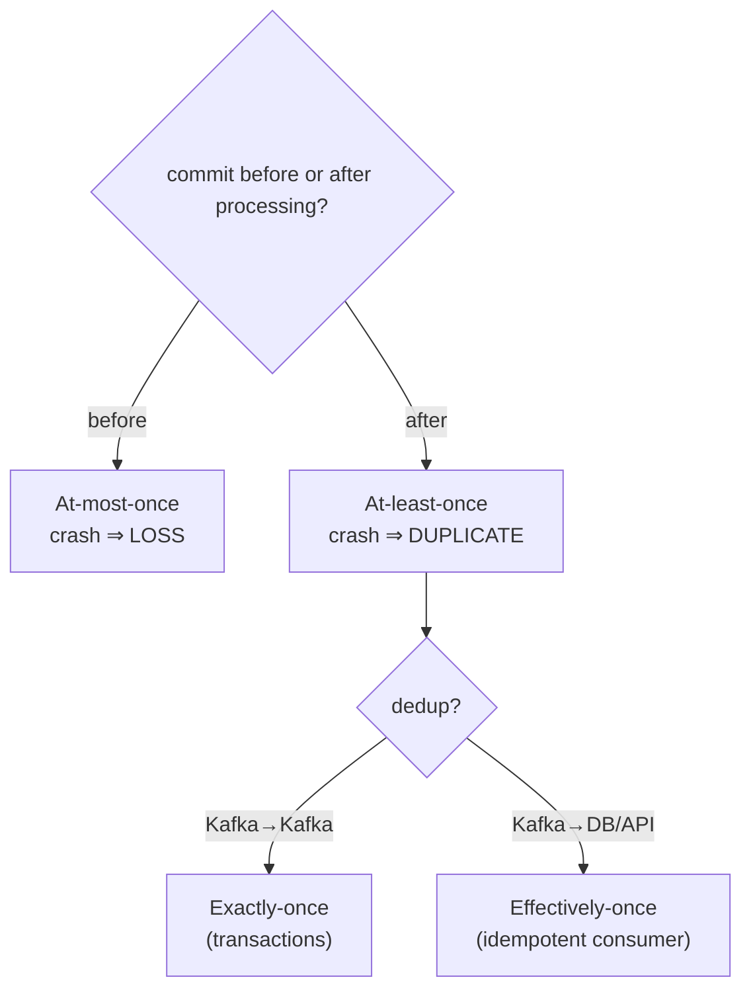

# 19 · Delivery Semantics

> متى تعمل commit (قبل/بعد المعالجة) بيحدد: **ضياع** أو **تكرار**. Exactly-once = at-least-once + dedup.



## Output حقيقي (examples/07)
```text
> after --crash 5              > before --crash 5
💳 charged pay-1..pay-5        💳 charged pay-1..pay-4
💥 CRASH (before commit)       💥 CRASH (after commit)
> after                        > before
💳 charged pay-5  ← DUPLICATE  💳 charged pay-6  ← pay-5 LOST
```

## Idempotent consumer (الحل العملي)
```sql
CREATE TABLE processed_events (
  consumer_group TEXT, event_id UUID,
  PRIMARY KEY (consumer_group, event_id)
);
```
```csharp
await using var tx = await db.BeginTransactionAsync();
var inserted = await db.ExecuteAsync(
    "INSERT INTO processed_events VALUES (@g, @id) ON CONFLICT DO NOTHING", new { g, id = e.EventId });
if (inserted == 1)
    await db.ExecuteAsync("UPDATE stock SET qty = qty - @q WHERE product = @p", ...);
await tx.CommitAsync();              // business change + dedup record: atomic
consumer.StoreOffset(r);             // then offset
```

## Natural idempotency
| ❌ Not idempotent | ✅ Idempotent |
|---|---|
| `balance = balance + 10` | `INSERT ... ON CONFLICT(tx_id) DO NOTHING` |
| `send email` | `if !sent(orderId) send` |
| `counter++` | `SET status = 'PAID' WHERE id = 7` |

## Summary
| | Loss | Dup | Cost |
|---|---|---|---|
| At-most-once | ✅ possible | ❌ | lowest |
| At-least-once | ❌ | ✅ possible | low — **default choice** |
| Exactly-once | ❌ | ❌ | tx overhead / dedup table |

## Key Points
- At-least-once + idempotent handler = 95% من الحالات
- EOS الحقيقي بس Kafka→Kafka
- الـ side effects الخارجية (email, HTTP) ما بتدخل بـ transaction

Next → [20-transactions-eos.md](20-transactions-eos.md)
