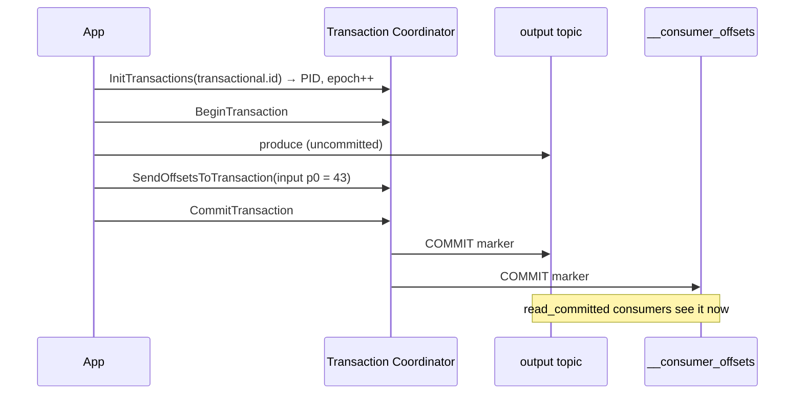
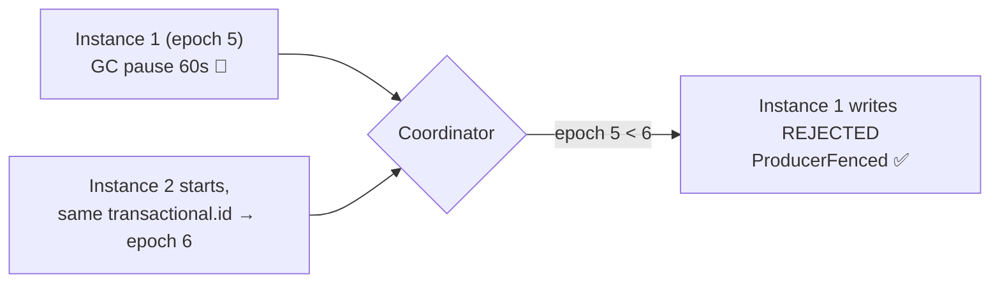

# 20 · Transactions & Exactly-Once (EOS)

> **Transaction** = كتابة لعدة partitions/topics + commit الـ consumer offset، **كلها أو ولا شي**. للـ pattern: consume → transform → produce.



## Output حقيقي (examples/09)
```text
read_uncommitted sees: committed-1, committed-2, committed-3, aborted-1, aborted-2, aborted-3
read_committed   sees: committed-1, committed-2, committed-3
EOS: 100 USD → 92.00 EUR  (input offset 0 committed in the same tx)
```

## Code (.NET)
```csharp
var producer = new ProducerBuilder<string, string>(new ProducerConfig
{
    TransactionalId = "fx-converter-1"          // stable per instance
}).Build();
producer.InitTransactions(TimeSpan.FromSeconds(10));

var r = consumer.Consume(ct);
producer.BeginTransaction();
producer.Produce("payments.eur", new() { Key = r.Message.Key, Value = Convert(r.Message.Value) });
producer.SendOffsetsToTransaction(
    [new TopicPartitionOffset(r.TopicPartition, r.Offset + 1)],
    consumer.ConsumerGroupMetadata, TimeSpan.FromSeconds(10));
producer.CommitTransaction();                   // on error → AbortTransaction()
```

## Zombie fencing


## Isolation level
| Consumer | Sees |
|---|---|
| `read_uncommitted` (default) | كل شي، حتى aborted |
| `read_committed` | committed فقط، لحد الـ **LSO** |

## التكلفة
| | Overhead |
|---|---|
| Per transaction | ~2 extra round-trips + markers |
| Batch 100 records / tx | overhead شبه معدوم |
| 1 record / tx | throughput ↓ كبير |
| `transaction.timeout.ms` | 60s default |

## Key Points
- EOS = idempotence + transactions + read_committed
- DB أو HTTP برا الـ transaction ❌
- Kafka Streams: `processing.guarantee=exactly_once_v2`

Next → [21-retention-compaction.md](../06-storage/21-retention-compaction.md)
