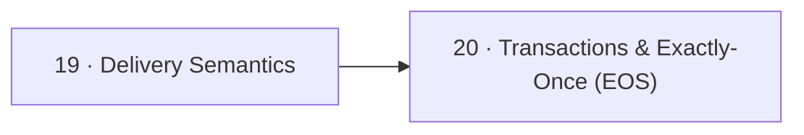

# 🎯 05 · Delivery Semantics — ضمانات التوصيل

> at-most / at-least / exactly-once، transactions

| # | Idea | One line |
|---|---|---|
| 19 | [Delivery Semantics](19-delivery-semantics.md) | متى تعمل commit (قبل/بعد المعالجة) بيحدد: **ضياع** أو **تكرار**. Exactly-once = at-least-once + dedup. |
| 20 | [Transactions & Exactly-Once (EOS)](20-transactions-eos.md) | **Transaction** = كتابة لعدة partitions/topics + commit الـ consumer offset، **كلها أو ولا شي**. للـ pattern: consume → transform → produce. |

← [Consumer](../04-consumer/README.md) · [Map](../../README.md) · [Storage](../06-storage/README.md) →
