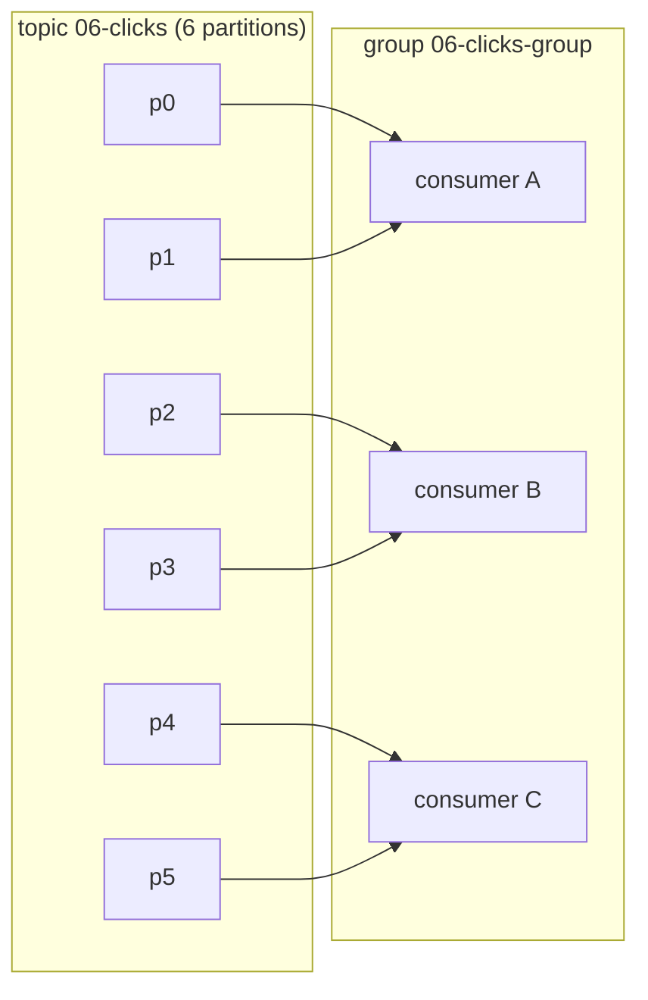
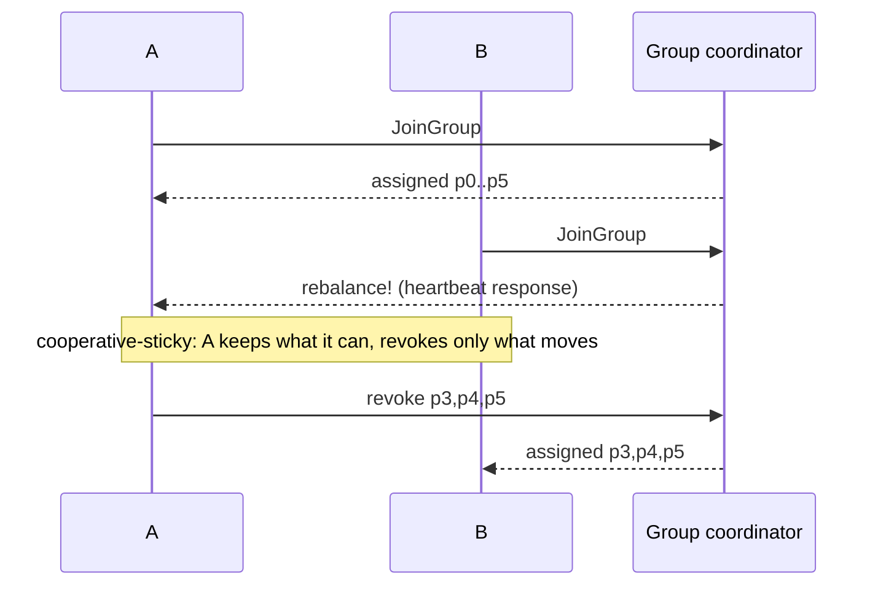

# 06 · Consumer groups & rebalancing

**Definition:** A **consumer group** is a set of consumers with the same `group.id`; Kafka gives each partition to exactly one member, and **rebalancing** moves partitions when members join or leave.

**Why it matters:** Groups are how you scale reading horizontally — and rebalances are the most common source of pauses and duplicates.

## Example

Partitions of `06-clicks` (6) as consumers join and leave group `06-clicks-group` with cooperative-sticky:

| Time | Event | A | B | C | Moved |
|---|---|---|---|---|---|
| t=2 s | A joins | 0 1 2 3 4 5 | – | – | 6 (first assignment) |
| t=8 s | B joins | 3 4 5 | 0 1 2 | – | 3 |
| t=14 s | C joins | 4 5 | 1 2 | 0 3 | 2 |
| t=20 s | A stops | – | 1 2 4 | 0 3 5 | 2 |

Only the partitions that move stop briefly; an eager rebalance would revoke all 6 each time.

## Diagram





Rebalance protocols:

| Protocol | How | Stop-the-world? |
|---|---|---|
| Classic + `range`/`roundrobin` (eager) | All members revoke everything, then re-assign | Yes |
| Classic + `cooperative-sticky` | Only moved partitions are revoked | No (incremental) |
| **`group.protocol=consumer`** (KIP-848, Kafka 4.0 GA) | Broker computes assignment; members heartbeat their state | No, and no group-wide sync barrier |

## Code

[examples/06-consumer-groups/Program.cs](../examples/06-consumer-groups/Program.cs)

```csharp
if (useNewProtocol)
{
    config.GroupProtocol = GroupProtocol.Consumer;
}
else
{
    config.PartitionAssignmentStrategy = PartitionAssignmentStrategy.CooperativeSticky;
}

using var consumer = new ConsumerBuilder<Ignore, Ignore>(config)
    .SetPartitionsAssignedHandler((cons, added) => Log(name, $"+ assigned [{Parts(added)}] ..."))
    .SetPartitionsRevokedHandler((cons, removed) => Log(name, $"- revoked  [{Parts(...)}]"))
    .Build();
```

`dotnet run` (classic, cooperative-sticky):

Output:

```text
protocol = classic + cooperative-sticky
  2.0s [A] joining group
  2.1s [A] + assigned [0,1,2,3,4,5]  now owns [0,1,2,3,4,5]
  8.0s [B] joining group
  8.2s [A] - revoked  [0,1,2]  now owns [3,4,5]
  9.2s [B] + assigned [0,1,2]  now owns [0,1,2]
 14.0s [C] joining group
 14.2s [B] - revoked  [0]  now owns [1,2]
 14.2s [A] - revoked  [3]  now owns [4,5]
 15.2s [C] + assigned [0,3]  now owns [0,3]
 20.0s [main] stopping A
 20.1s [A] - revoked  [4,5]  now owns []
 20.1s [A] left group
 20.3s [B] + assigned [4]  now owns [1,2,4]
 20.3s [C] + assigned [5]  now owns [0,3,5]
 26.2s [B] - revoked  [1,2,4]  now owns []
 26.2s [C] - revoked  [0,3,5]  now owns []
 26.2s [B] left group
 26.2s [C] left group
```

`dotnet run consumer` (new KIP-848 protocol):

```text
protocol = consumer (KIP-848)
  1.9s [A] joining group
  2.1s [A] + assigned [0,1,2,3,4,5]  now owns [0,1,2,3,4,5]
  7.9s [B] joining group
 12.2s [A] - revoked  [3,4,5]
 12.2s [A] + assigned []  now owns [0,1,2]
 13.0s [B] + assigned [3,4,5]  now owns [3,4,5]
 13.9s [C] joining group
 17.2s [A] - revoked  [2]
 17.2s [A] + assigned []  now owns [0,1]
 18.1s [B] - revoked  [5]
 18.1s [B] + assigned []  now owns [3,4]
 19.1s [C] + assigned [2,5]  now owns [2,5]
 19.9s [main] stopping A
 20.0s [A] - revoked  [0,1]
 20.0s [A] left group
 23.1s [B] + assigned [1]  now owns [1,3,4]
 24.1s [C] + assigned [0]  now owns [0,2,5]
 26.2s [C] - revoked  [0,2,5]
 26.2s [B] - revoked  [1,3,4]
 26.2s [C] left group
 26.2s [B] left group
```

## ✅ Correct vs ❌ wrong usage

| | Usage | Reason |
|---|---|---|
| ✅ | Consumers in a group ≤ partitions | Extra consumers sit idle |
| ✅ | Different services use different `group.id`s | Each service gets **all** events |
| ✅ | Commit offsets in the revoked handler (manual commit) | The next owner starts where you stopped |
| ❌ | Same `group.id` for billing and shipping | They split the events; each sees only part |
| ❌ | 10 consumers for a 3-partition topic | 7 idle consumers |

## Pitfalls

1. Long processing > `max.poll.interval.ms` triggers rebalance storms.
2. Rolling deploys cause N rebalances; use cooperative-sticky or KIP-848, and `group.instance.id` (static membership) for fast restarts.
3. With the new `consumer` protocol you must **not** set `partition.assignment.strategy` or `session.timeout.ms` on the client (the broker owns them).
4. Partition handlers run inside `Consume()`; never block them for long.

**Next:** [07 · Keys & ordering](07-keys-ordering.md)
