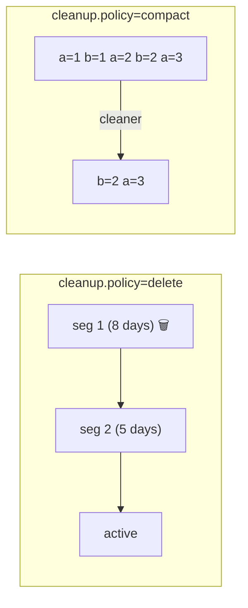
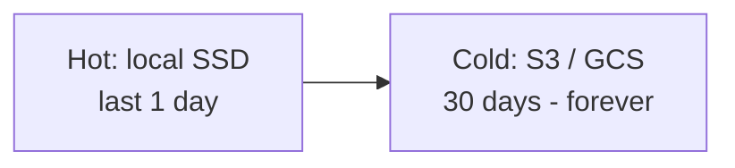

# 21 · Retention & Log Compaction

> Kafka بتحذف بطريقتين: **delete** (حسب الزمن/الحجم) أو **compact** (خلي آخر value لكل key).



## Delete policy
| Config | Default | يعني |
|---|---|---|
| `retention.ms` | 7 days | segment كامل أقدم من هيك ⇒ حذف |
| `retention.bytes` | -1 | حد الحجم **per partition** |
| `segment.ms` / `segment.bytes` | 7d / 1GB | متى يتسكّر الـ segment |
| `log.retention.check.interval.ms` | 5 min | كل قديش يفحص |

> الحذف **per segment**، مش per record → record ممكن يعيش أطول من `retention.ms` لحد ما الـ segment تبعه يتسكّر.

## Compaction — output حقيقي (examples/10)
```text
BEFORE (16): @0:alice=v1 @1:bob=v1 @2:carol=v1 ... @12:alice=v5 @13:bob=v5 @14:carol=v5 @15:carol=∅
AFTER  (7):  @12:alice=alice-v5 | @13:bob=bob-v5 | @19:tick=... 
```
- `alice`, `bob` → آخر نسخة فقط
- `carol` → tombstone (`value=null`) ⇒ انحذف كلياً بعد `delete.retention.ms`
- الـ offsets **ما انعادت ترقيمها** (12, 13, 19)

## Compaction configs
| Config | يعني |
|---|---|
| `min.cleanable.dirty.ratio` (0.5) | نسبة الـ "dirty" قبل ما يشتغل الـ cleaner |
| `min.compaction.lag.ms` (0) | أقل عمر قبل الـ compaction |
| `delete.retention.ms` (1 day) | قديش يبقى الـ tombstone ظاهر |
| `cleanup.policy=compact,delete` | الاثنين: آخر value + حد زمني |

## Use cases
| Topic | Policy |
|---|---|
| Events (`order.created`) | delete, 7-30 days |
| State / changelog (`user.profile`) | **compact** |
| CDC table snapshot | compact |
| `__consumer_offsets` | compact |
| Audit / legal | delete, `retention.ms=-1` + tiered storage |

## Tiered storage (KIP-405, GA 3.9)

- `remote.storage.enable=true` + `local.retention.ms=86400000`

## Key Points
- Compaction = "table" من stream
- Tombstone = حذف key
- الـ active segment ما بينضغط

Next → [22-storage-internals.md](22-storage-internals.md)
