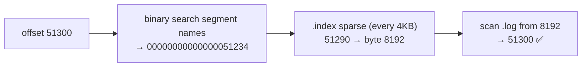
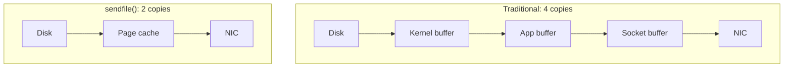

# 22 · Storage Internals: ليش Kafka سريعة؟

> partition = folder فيه **segments**. كل segment = ملف `.log` + indexes. السرعة من: sequential I/O + page cache + zero-copy + batching.

## على الديسك
```text
/tmp/kafka-logs/shop.order.created-0/
├── 00000000000000000000.log        ← records (offset 0 .. 51233)
├── 00000000000000000000.index      ← offset → byte position (sparse)
├── 00000000000000000000.timeindex  ← timestamp → offset
├── 00000000000000051234.log        ← active segment (writes go here)
├── 00000000000000051234.index
├── 00000000000000051234.timeindex
├── leader-epoch-checkpoint
└── partition.metadata
```
```bash
docker exec kafka-1 ls -la /tmp/kafka-logs/demo.orders-0/
docker exec kafka-1 /opt/kafka/bin/kafka-dump-log.sh --print-data-log \
  --files /tmp/kafka-logs/demo.orders-0/00000000000000000000.log
```
Output حقيقي (بعد examples/02):
```text
baseOffset: 0 lastOffset: 139 count: 140 producerId: 0 producerEpoch: 0 baseSequence: 0
  isTransactional: false size: 1684 compresscodec: lz4
| offset: 0 key: customer-5  payload: bulk-5   sequence: 0
| offset: 1 key: customer-18 payload: bulk-18  sequence: 1
```
→ **batch واحد = 140 record = 1684 bytes ≈ 12 B/record** (batching + lz4). لاحظ `producerId` + `sequence` = الـ idempotence ([13](../03-producer/13-idempotent-producer.md)).

## Lookup offset 51300


## 4 أسرار السرعة
| سر | الشرح |
|---|---|
| **Sequential I/O** | append فقط → الديسك بأقصى سرعة |
| **Page cache** | Kafka ما بتعمل cache بالـ JVM heap؛ الـ OS بيعمل. consumers الحديثين بيقرأوا من الـ RAM |
| **Zero-copy** (`sendfile`) | disk → socket بدون ما تمر على user space |
| **Batching + compression** | batch مضغوط بينكتب وبيتنسخ وبينقرأ **بدون فك ضغط** على الـ broker |

## Zero-copy

> ⚠ مع TLS، الـ zero-copy بيتعطل (لازم encryption بالـ user space).

## Numbers
| | Value |
|---|---|
| Broker JVM heap الموصى فيه | 6 GB (الباقي للـ page cache) |
| RAM لـ page cache | ≈ write rate × 30s+ |
| مثال: 100 MB/s writes | ≥ 3 GB page cache لتظل القراءات من RAM |

## Key Points
- لا تعطي Kafka heap كبير
- الـ consumer المتأخر = قراءة ديسك
- الـ segment = وحدة الحذف والـ compaction

Next → [23-serialization-schema.md](../07-integration-patterns/23-serialization-schema.md)
