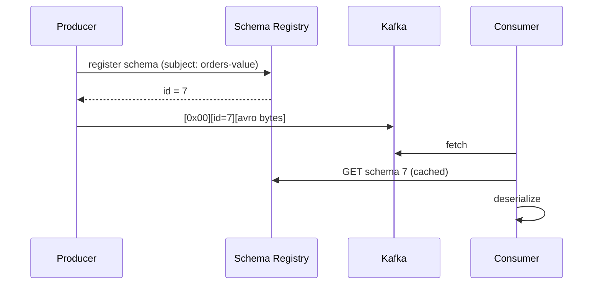

# 23 · Serialization & Schema Registry

> Kafka بتخزن **bytes**. الـ **schema** هو العقد بين producer و consumer — تغييره بدون ضبط = consumers مكسورة.



## Wire format
```text
byte 0     : magic byte 0x00
bytes 1-4  : schema id (int32, big-endian)
bytes 5..  : payload (Avro / Protobuf / JSON)
```

## Formats
| | JSON | Avro | Protobuf |
|---|---|---|---|
| Size (مثال order) | ~180 B | ~45 B | ~50 B |
| Schema | اختياري (JSON Schema) | إجباري | إجباري (.proto) |
| Human readable | ✅ | ❌ | ❌ |
| .NET support | System.Text.Json | Apache.Avro | Google.Protobuf ✅ الأسهل |

## .NET (Protobuf + Schema Registry)
```csharp
// dotnet add package Confluent.SchemaRegistry.Serdes.Protobuf
var sr = new CachedSchemaRegistryClient(new SchemaRegistryConfig { Url = "http://localhost:8081" });

var producer = new ProducerBuilder<string, OrderCreated>(config)
    .SetValueSerializer(new ProtobufSerializer<OrderCreated>(sr))
    .Build();

var consumer = new ConsumerBuilder<string, OrderCreated>(cConfig)
    .SetValueDeserializer(new ProtobufDeserializer<OrderCreated>().AsSyncOverAsync())
    .Build();
```

## Compatibility modes
| Mode | مسموح | مين يترقى أول |
|---|---|---|
| **BACKWARD** (default) | حذف field، إضافة field **مع default** | consumers أول |
| FORWARD | إضافة field، حذف field مع default | producers أول |
| FULL | الاثنين | أي ترتيب |
| NONE | أي شي ❌ | — |

## Evolution مثال
```text
v1: { orderId, total }
v2: { orderId, total, currency = "USD" }   ✅ BACKWARD (new field with default)
v3: { orderId, amount }                    ❌ rename = delete + add without default
```

## Key Points
- Schema = API contract
- Version بالـ event type (`order.created.v2`) للتغييرات الكبيرة
- JSON بدون schema ⇒ runtime surprises

Next → [24-error-handling-dlq.md](24-error-handling-dlq.md)
