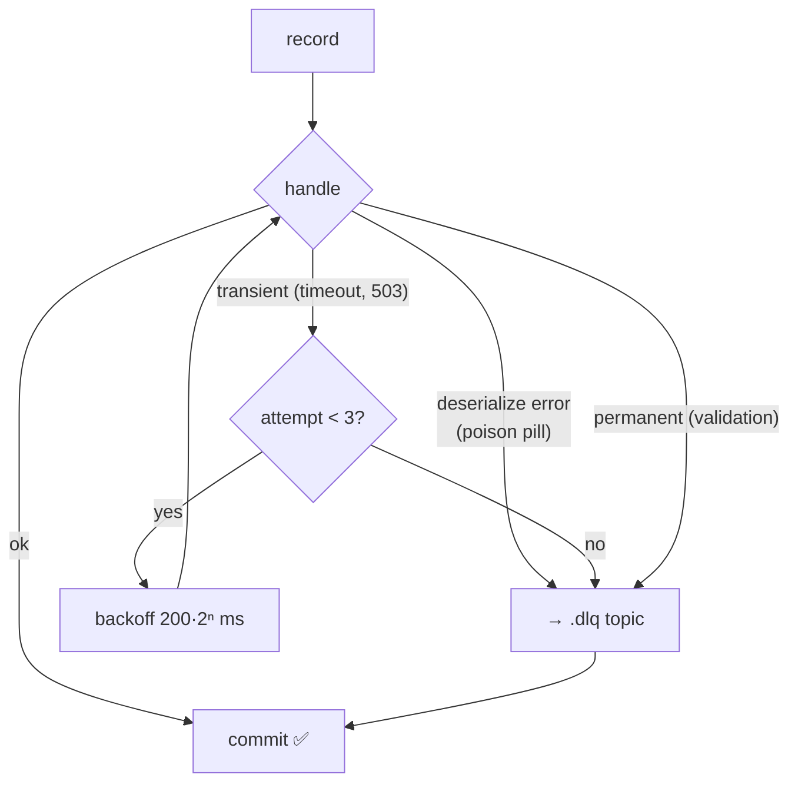
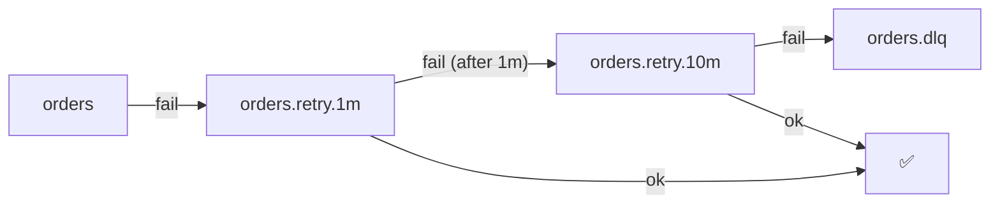

# 24 · Error Handling: Retry & DLQ

> record فاشلة لازم **ما توقف الـ partition**. retry للأخطاء المؤقتة، و **DLQ** للدائمة.



## Output حقيقي (examples/08)
```text
p0@7 POISON-3
   🔁 attempt 1 failed: address does not exist → retry in 200ms
   🔁 attempt 2 failed: address does not exist → retry in 400ms
   ☠️ → demo.shipments.dlq: address does not exist
p0@8 FLAKY-4
   🔁 attempt 1 failed: carrier API timeout → retry in 200ms
   🔁 attempt 2 failed: carrier API timeout → retry in 400ms
   ✅ shipped FLAKY-4
p0@9 ship-5
   ✅ shipped ship-5          ← partition never got stuck
```

## DLQ headers (للتحقيق والـ replay)
```csharp
Headers = new Headers
{
    { "dlq-reason",   Encoding.UTF8.GetBytes(ex.Message) },
    { "dlq-original", Encoding.UTF8.GetBytes($"{r.Topic}[{r.Partition}]@{r.Offset}") },
    { "dlq-attempts", Encoding.UTF8.GetBytes("3") }
}
```

## Retry topics (non-blocking, للـ delays الطويلة)

| In-process retry | Retry topics |
|---|---|
| بسيط | معقد (topics + consumers) |
| بيوقف الـ partition خلال الـ backoff | ما بيوقف |
| ✅ backoff ثواني | ✅ backoff دقائق/ساعات |
| يحافظ على الترتيب | ❌ بيكسر الترتيب |

## Error classification
| Error | نوع | Action |
|---|---|---|
| `JsonException` | permanent | DLQ فوراً |
| Validation | permanent | DLQ فوراً |
| `TimeoutException`, HTTP 503 | transient | retry |
| DB deadlock | transient | retry |
| Bug (NullReference) | permanent* | DLQ + alert، fix، replay |

## Key Points
- DLQ لازم يكون إله monitoring + alert
- DLQ بدون replay tool = مقبرة
- لا تعيد المحاولة للأبد بالـ loop

Next → [25-outbox-pattern.md](25-outbox-pattern.md)
