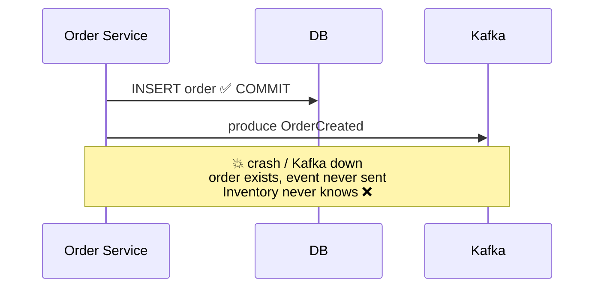
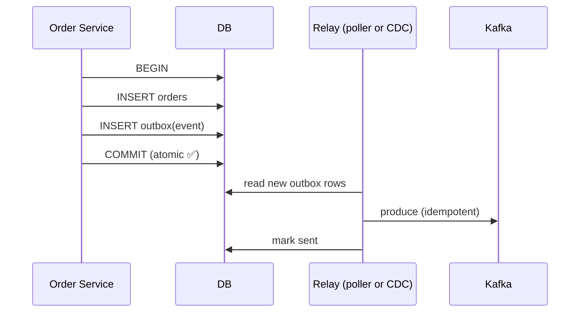

# 25 · Transactional Outbox

> **Dual-write problem**: تكتب بالـ DB وتبعت لـ Kafka — ما في transaction بينهم. الحل: اكتب الـ event **بنفس DB transaction** بجدول `outbox`، وحدا تاني بينقله لـ Kafka.

## المشكلة

| الترتيب | الفشل |
|---|---|
| DB ثم Kafka | order بدون event |
| Kafka ثم DB | event لـ order مش موجود (rollback) |

## الحل


## Table
```sql
CREATE TABLE outbox (
  id          UUID PRIMARY KEY,         -- = EventId (dedup downstream)
  aggregate_id TEXT NOT NULL,           -- = Kafka key
  topic       TEXT NOT NULL,
  payload     JSONB NOT NULL,
  created_at  TIMESTAMPTZ DEFAULT now(),
  sent_at     TIMESTAMPTZ NULL
);
```

## Polling relay (.NET BackgroundService)
```csharp
while (!ct.IsCancellationRequested)
{
    var rows = await db.QueryAsync<OutboxRow>(
        "SELECT * FROM outbox WHERE sent_at IS NULL ORDER BY created_at LIMIT 100 FOR UPDATE SKIP LOCKED");
    foreach (var row in rows)
        await producer.ProduceAsync(row.Topic, new() { Key = row.AggregateId, Value = row.Payload });
    await db.ExecuteAsync("UPDATE outbox SET sent_at = now() WHERE id = ANY(@ids)", new { ids = rows.Select(r => r.Id) });
    await Task.Delay(500, ct);
}
```

## Polling vs CDC (Debezium)
| | Polling | CDC (Debezium) |
|---|---|---|
| Latency | 100ms-1s | ~ms |
| DB load | queries متكررة | يقرأ الـ WAL/binlog |
| Infra | لا شي | Kafka Connect + Debezium |
| Delivery | at-least-once | at-least-once |

## Key Points
- Outbox = الحل القياسي للـ microservices
- الـ relay ممكن يكرر ⇒ consumer لازم idempotent
- ترتيب per aggregate: key = aggregate_id

Next → [26-kafka-connect.md](26-kafka-connect.md)
