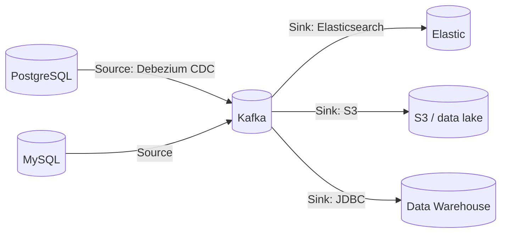
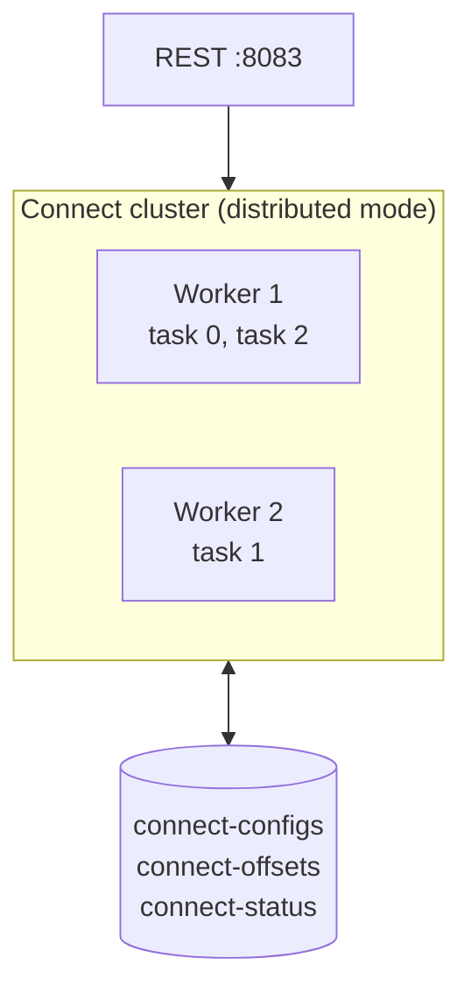

# 26 · Kafka Connect

> framework جاهز لنقل الداتا **من/إلى** Kafka بدون كتابة كود: config JSON فقط.



## Architecture

| مفهوم | يعني |
|---|---|
| Connector | الـ job (config) |
| Task | وحدة التوازي (`tasks.max`) |
| Worker | JVM process |
| Converter | bytes ⇄ struct (JSON/Avro/Protobuf) |
| **SMT** | Single Message Transform (rename, mask, route) |

## Example: Debezium Postgres → Kafka
```json
POST http://localhost:8083/connectors
{
  "name": "orders-cdc",
  "config": {
    "connector.class": "io.debezium.connector.postgresql.PostgresConnector",
    "database.hostname": "postgres",
    "database.user": "debezium",
    "database.password": "secret",
    "database.dbname": "shop",
    "topic.prefix": "shop",
    "table.include.list": "public.outbox",
    "transforms": "outbox",
    "transforms.outbox.type": "io.debezium.transforms.outbox.EventRouter"
  }
}
```
→ كل INSERT بجدول `outbox` ⇒ record بـ Kafka خلال ms ([25](25-outbox-pattern.md)).

## CDC event shape
```json
{ "before": { "id": 7, "status": "NEW" },
  "after":  { "id": 7, "status": "PAID" },
  "op": "u", "ts_ms": 1790771503023 }
```

## متى Connect ومتى كود؟
| Connect ✅ | Custom code ✅ |
|---|---|
| DB → Kafka (CDC) | business logic |
| Kafka → S3/Elastic/Snowflake | calls لـ APIs مع retries مخصصة |
| 200+ connectors جاهزة | transformation معقدة |

## Key Points
- Source = إلى Kafka، Sink = من Kafka
- Connect بيدير الـ offsets لحاله
- Debezium = معيار الـ CDC

Next → [27-stream-processing.md](27-stream-processing.md)
