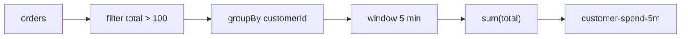
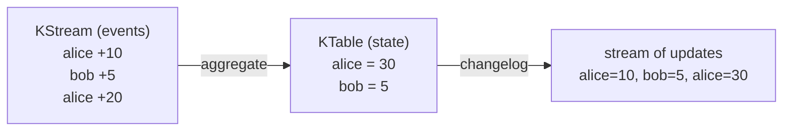

# 27 · Stream Processing: Kafka Streams, ksqlDB, Flink

> معالجة الـ events **وهي ماشية**: filter, map, join, aggregate, window — والنتيجة topic جديد.



## Stream vs Table (duality)

| | KStream | KTable |
|---|---|---|
| كل record | event مستقل (INSERT) | update لـ key (UPSERT) |
| Topic | delete policy | compacted |

## Windows
| Type | مثال |
|---|---|
| Tumbling | كل 5 دقائق ثابتة: 10:00-10:05, 10:05-10:10 |
| Hopping | 5 دقائق كل دقيقة (متداخلة) |
| Session | activity + inactivity gap 30 دقيقة |
| Sliding | ضمن X من بعض (joins) |

## ksqlDB (SQL على streams)
```sql
CREATE STREAM orders (customerId VARCHAR KEY, total DECIMAL(10,2))
  WITH (KAFKA_TOPIC='shop.order.created', VALUE_FORMAT='JSON');

CREATE TABLE spend_5m AS
  SELECT customerId, SUM(total) AS spent
  FROM orders WINDOW TUMBLING (SIZE 5 MINUTES)
  GROUP BY customerId EMIT CHANGES;
```

## .NET options
| Tool | Language | Note |
|---|---|---|
| Kafka Streams | Java/Kotlin فقط | الأقوى، embedded library |
| **Streamiz.Kafka.Net** | C# | port لـ Kafka Streams |
| ksqlDB | SQL (REST) | ⚠ Confluent Community License، تطويره بطيء |
| **Apache Flink** | Java/SQL/Python | الأقوى للـ state الكبير |
| Consumer loop يدوي | C# | للحالات البسيطة (filter/map) |

## Event time vs Processing time
```text
Event created on phone: 10:00:00 (event time)
Arrived at Kafka:       10:04:30 (offline user)
Processed:              10:04:31 (processing time)
→ windows on event time + grace period for late events
```

## Key Points
- State محلي (RocksDB) + changelog topic
- Exactly-once built-in (`exactly_once_v2`)
- Join = نفس عدد partitions + نفس key (co-partitioning)

Next → [28-security.md](../08-operations/28-security.md)
