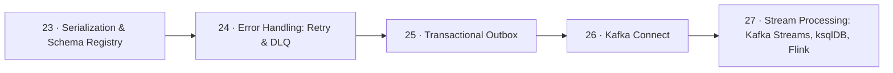

# 🔌 07 · Integration Patterns — أنماط التكامل

> schema، retry/DLQ، outbox، Connect، stream processing

| # | Idea | One line |
|---|---|---|
| 23 | [Serialization & Schema Registry](23-serialization-schema.md) | Kafka بتخزن **bytes**. الـ **schema** هو العقد بين producer و consumer — تغييره بدون ضبط = consumers مكسورة. |
| 24 | [Error Handling: Retry & DLQ](24-error-handling-dlq.md) | record فاشلة لازم **ما توقف الـ partition**. retry للأخطاء المؤقتة، و **DLQ** للدائمة. |
| 25 | [Transactional Outbox](25-outbox-pattern.md) | **Dual-write problem**: تكتب بالـ DB وتبعت لـ Kafka — ما في transaction بينهم. الحل: اكتب الـ event **بنفس DB transaction** بجدول `outbox`، وحدا تاني بينقله لـ Kafka. |
| 26 | [Kafka Connect](26-kafka-connect.md) | framework جاهز لنقل الداتا **من/إلى** Kafka بدون كتابة كود: config JSON فقط. |
| 27 | [Stream Processing: Kafka Streams, ksqlDB, Flink](27-stream-processing.md) | معالجة الـ events **وهي ماشية**: filter, map, join, aggregate, window — والنتيجة topic جديد. |

← [Storage](../06-storage/README.md) · [Map](../../README.md) · [Operations](../08-operations/README.md) →
