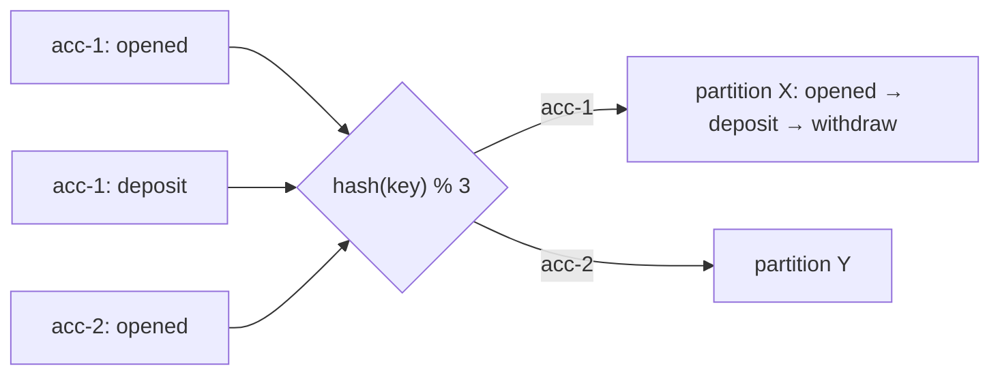

# 07 · Keys & ordering

**Definition:** The record **key** is hashed to choose a partition, so all records with the same key land in the same partition and keep their order.

**Why it matters:** "Withdraw before deposit" bugs disappear when all events of one account share a key. Mixing .NET and Java producers with default settings silently breaks this.

## Example

```
Initial data:
  topic                : 07-account-events, 3 partitions
  events               : 5 accounts × (opened, deposit, withdraw) = 15 per run

Commands:
  .NET default hash    : acc-1→2  acc-2→0  acc-3→2  acc-4→0  acc-5→0
  murmur2 (Java) hash  : acc-1→0  acc-2→2  acc-3→2  acc-4→2  acc-5→1
  read partition 0     : acc-1: opened → deposit → withdraw

Result:
  per key              : always exactly 1 partition → order kept
  .NET vs Java         : 4 of 5 keys land on a different partition
```

## Diagram



| Partitioner | Hash | Used by default in |
|---|---|---|
| `consistent_random` | CRC32 | **librdkafka / Confluent.Kafka (.NET), Python, Go** |
| `murmur2_random` | murmur2 | **Java client**, Kafka Streams, Connect |

Same key + different hash ⇒ **different partition** between a .NET and a Java producer.

## Code

[examples/07-keys-ordering/Program.cs](../examples/07-keys-ordering/Program.cs)

```csharp
var config = new ProducerConfig { BootstrapServers = bootstrap, Partitioner = Partitioner.Murmur2Random };

var result = await producer.ProduceAsync(topic, new Message<string, string> { Key = key, Value = step });
```

Output:

```text
key    | .NET default (consistent_random, CRC32) | Java default (murmur2)
-------+-----------------------------------------+----------------------
acc-1  | partition 2                             | partition 0
acc-2  | partition 0                             | partition 2
acc-3  | partition 2                             | partition 2
acc-4  | partition 0                             | partition 2
acc-5  | partition 0                             | partition 1

partition 0 (murmur2 run): acc-1:opened  acc-1:deposit  acc-1:withdraw
partition 1 (murmur2 run): acc-5:opened  acc-5:deposit  acc-5:withdraw
partition 2 (murmur2 run): acc-2:opened  acc-3:opened  acc-4:opened  acc-2:deposit  acc-3:deposit  acc-4:deposit  acc-2:withdraw  acc-3:withdraw  acc-4:withdraw
```

The table shows a single partition per key (order guaranteed) but the two hash functions pick **different** partitions for 4 of 5 keys.

## ✅ Correct vs ❌ wrong usage

| | Usage | Reason |
|---|---|---|
| ✅ | Key = entity id (`accountId`, `orderId`) | All events of one entity in order |
| ✅ | `Partitioner = Murmur2Random` when Java services (or Kafka Streams) share the topic | Same key → same partition everywhere |
| ❌ | Key = `DateTime.Now` or a random GUID per event | No ordering benefit, uneven spread |
| ❌ | Key = country with 1 huge country | **Hot partition**: one consumer does most work |
| ❌ | Increasing partition count on a keyed topic | `hash % N` changes; old and new events of a key split |

## Pitfalls

1. Null key → spread across partitions, no ordering.
2. Ordering also needs `max.in.flight ≤ 5` **with idempotence** (default in idempotent mode) — otherwise a retry can reorder batches.
3. Skewed keys create hot partitions; monitor per-partition lag.
4. Ordering is per partition; consumers processing in parallel threads can still reorder — keep one thread per key.

**Next:** [08 · Delivery semantics](08-delivery-semantics.md)
