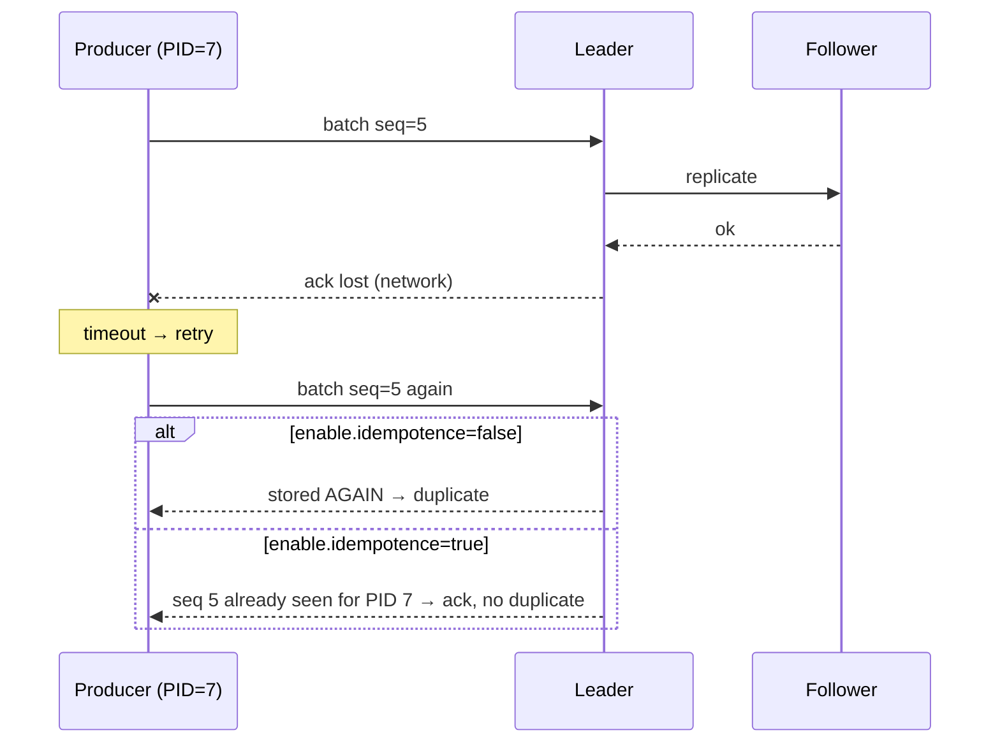

# 08 · Delivery semantics (producer side)

**Definition:** **Delivery semantics** say how many times an event can end up in Kafka when things fail: *at-most-once* (0–1), *at-least-once* (1–n), *exactly-once* (1).

**Why it matters:** A network timeout after the broker stored a batch makes the producer retry → duplicate. `acks` and **idempotence** decide whether you lose or duplicate data.

## Example

```
Initial data:
  topic                : 08-sensor-readings, RF 3, min.insync.replicas 2
  test                 : 500 sequential awaited sends per setting

Commands:
  acks=0               : status PossiblyPersisted, offset unknown, 5.502 ms/msg
  acks=1               : status Persisted, 7.066 ms/msg
  acks=all             : status Persisted, 9.489 ms/msg
  acks=all + idempotent: status Persisted, 8.646 ms/msg

Result:
  acks=all vs acks=0   : +3.987 ms per awaited message (~1.7×)
  idempotence cost     : none measurable (8.646 vs 9.489 ms, noise)
```

## Diagram



| `acks` | Leader waits for | Loses data when | Latency |
|---|---|---|---|
| `0` | nothing (no response) | network drop, broker crash | lowest |
| `1` | its own disk write | leader dies before followers copy | low |
| `all` (`-1`) | all **in-sync** replicas (≥ `min.insync.replicas`) | all ISR die at once | higher |

Idempotent producer = `acks=all` + retries + `max.in.flight ≤ 5` + producer id/sequence numbers per partition.

## Code

[examples/08-delivery-semantics/Program.cs](../examples/08-delivery-semantics/Program.cs)

```csharp
var config = new ProducerConfig { BootstrapServers = bootstrap, Acks = acks, EnableIdempotence = idempotent };

using var producer = new ProducerBuilder<string, string>(config).Build();

for (var i = 0; i < messages; i++)
{
    await producer.ProduceAsync(topic, new Message<string, string> { Key = "sensor-1", Value = $"{20 + i % 10}.0" });
}
```

Output:

```text
acks    | idempotent | first result                     | avg latency (awaited, 500 msgs)
--------+------------+----------------------------------+--------------------------------
None    | False      | status=PossiblyPersisted offset=unknown | 5.502 ms
Leader  | False      | status=Persisted         offset=2505    | 7.066 ms
All     | False      | status=Persisted         offset=3006    | 9.489 ms
All     | True       | status=Persisted         offset=3507    | 8.646 ms
```

Note `acks=0`: status is `PossiblyPersisted` and the offset is unknown — the producer never learns whether the broker stored it. The idempotent run is not slower than plain `acks=all` (8.646 vs 9.489 ms): the difference is noise.

## ✅ Correct vs ❌ wrong usage

| | Usage | Reason |
|---|---|---|
| ✅ | `EnableIdempotence = true` for anything business-critical | No duplicates or reordering from retries, tiny cost |
| ✅ | `acks=all` + topic `min.insync.replicas=2` + RF=3 | Survives 1 broker loss with no data loss |
| ✅ | `acks=0` for metrics/telemetry you can afford to lose | Lowest latency |
| ❌ | `acks=all` with `min.insync.replicas=1` | "all" may mean just the leader → data loss on failover |
| ❌ | Thinking idempotence de-duplicates across app restarts | It covers retries of one producer session only; use transactions or consumer-side dedupe |

## Pitfalls

1. Idempotence removes **broker-side** duplicates from retries, not duplicates your app creates by calling `Produce` twice.
2. `message.timeout.ms` expiry = message **failed**; you must handle the error (retry, log, DLQ).
3. `acks=all` latency is bound by the slowest in-sync follower.
4. Exactly-once end-to-end needs transactions + `read_committed` consumers (see [16](16-transactions-eos.md)).

**Next:** [09 · Offset commits](09-offset-commits.md)
