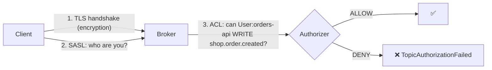

# 28 · Security: TLS, SASL, ACLs

> 3 طبقات: **Encryption** (TLS) + **Authentication** (SASL/mTLS) + **Authorization** (ACLs).



## Protocols
| `security.protocol` | Encryption | Auth |
|---|---|---|
| `PLAINTEXT` | ❌ | ❌ (هاد الـ repo — dev فقط) |
| `SSL` | ✅ | اختياري mTLS |
| `SASL_PLAINTEXT` | ❌ | ✅ |
| **`SASL_SSL`** | ✅ | ✅ ← **prod** |

## SASL mechanisms
| Mechanism | ملاحظة |
|---|---|
| PLAIN | user/pass (لازم TLS) |
| **SCRAM-SHA-512** | passwords hashed بالـ metadata |
| OAUTHBEARER | OIDC tokens (Keycloak, Entra ID) |
| GSSAPI | Kerberos |

## .NET config
```csharp
var config = new ProducerConfig
{
    BootstrapServers = "broker1:9093",
    SecurityProtocol = SecurityProtocol.SaslSsl,
    SaslMechanism = SaslMechanism.ScramSha512,
    SaslUsername = "orders-api",
    SaslPassword = Environment.GetEnvironmentVariable("KAFKA_PASSWORD"),
    SslCaLocation = "/etc/kafka/ca.pem"
};
```

## ACLs (least privilege)
```bash
# producer: write only its topic
kafka-acls.sh --bootstrap-server b:9093 --command-config admin.properties --add \
  --allow-principal User:orders-api --operation Write --topic shop.order.created

# consumer: read topic + use its group
kafka-acls.sh ... --add --allow-principal User:inventory \
  --operation Read --topic shop.order.created --group inventory-service
```
| Principal | Topic | Operations |
|---|---|---|
| `orders-api` | `shop.order.created` | Write, Describe |
| `inventory` | `shop.order.created` | Read, Describe |
| `inventory` | group `inventory-service` | Read |

## Key Points
- ACL على topic **و** group للـ consumer
- `allow.everyone.if.no.acl.found=false`
- Credentials من secrets، مش appsettings

Next → [29-monitoring.md](29-monitoring.md)
