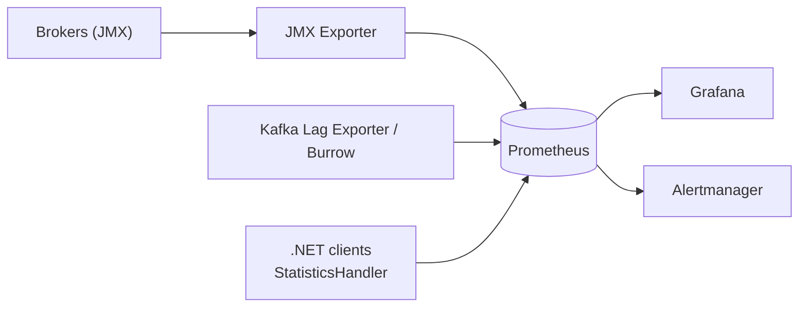
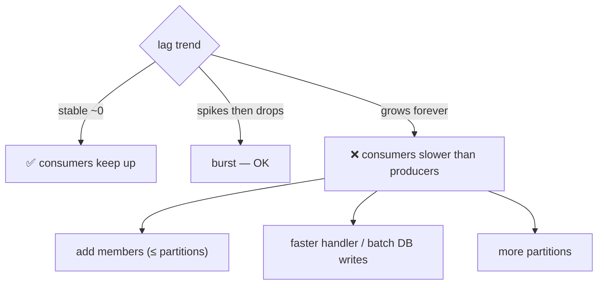

# 29 · Monitoring

> أهم رقم بالكون: **consumer lag**. بعده: under-replicated partitions و request latency.



## Golden metrics
| Metric | Healthy | Alert |
|---|---|---|
| **Consumer lag** (records) | ثابت أو ينزل | يطلع باستمرار 10 دقائق |
| Lag (seconds) | < SLA | > SLA |
| `UnderReplicatedPartitions` | 0 | > 0 لمدة 5m |
| `OfflinePartitionsCount` | 0 | > 0 🚨 |
| `ActiveControllerCount` (sum) | 1 | ≠ 1 |
| Request latency p99 (Produce) | < 50ms | > 200ms |
| Disk usage | < 70% | > 85% |
| Network processor idle | > 30% | < 20% |

## Lag: شو معناه؟


## Lag من .NET — output حقيقي (examples/12)
> 03-Consumer قرأ كل شي ووقف، بعدها 02-Producer بعت 1006 record جديدة:
```text
topic                partition  committed  end      lag
demo.orders                  0        140  280      140
demo.orders                  1        242  484      242
demo.orders                  2        172  344      172
demo.orders                  3        172  344      172
demo.orders                  4        180  360      180
demo.orders                  5        100  200      100
TOTAL LAG = 1006
```
→ شغّل 03-Consumer مرة تانية ⇒ lag = 0.

## CLI
```bash
docker exec kafka-1 /opt/kafka/bin/kafka-consumer-groups.sh \
  --bootstrap-server localhost:19092 --describe --group demo-reader
```

## .NET client statistics
```csharp
var config = new ConsumerConfig { StatisticsIntervalMs = 10_000 };
new ConsumerBuilder<string, string>(config)
    .SetStatisticsHandler((_, json) => metrics.Publish(json))   // rxmsgs, consumer_lag, rtt...
```

## Key Points
- Lag بالثواني أوضح من بالعدد
- راقب الـ DLQ size
- Alert على الـ trend، مش القيمة لحظياً

Next → [30-ui-tools.md](30-ui-tools.md)
