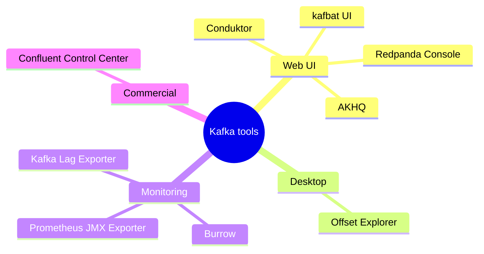

# 30 · UI & Tools

> أدوات تشوف فيها الـ topics والرسائل والـ groups والـ lag بدل الـ CLI.



## مقارنة
| Tool | License | ميزة |
|---|---|---|
| **kafbat/kafka-ui** | Apache 2.0 | الـ fork الفعال من provectus — مستخدم بـ هاد الـ repo |
| AKHQ | Apache 2.0 | ACLs + Schema Registry + Connect |
| Redpanda Console | BSL/free | UI ممتاز، بيشتغل مع Kafka العادي |
| Conduktor | Freemium | desktop/web، features كثيرة |
| Offset Explorer | free (personal) | desktop app، سابقاً **Kafka Tool** |
| Confluent Control Center | Commercial | مع Confluent Platform |
| Burrow | Apache 2.0 | lag evaluation (LinkedIn) — **مش UI للرسائل** |

## ⚠ تصحيح لـ Gemini
| قال | الصح |
|---|---|
| `provectuslabs/kafka-ui:latest` | ما عاد يتطور ⇒ `ghcr.io/kafbat/kafka-ui` |
| "Offset Explorer (سابقاً Burrow / Kafka Tool)" | Offset Explorer = سابقاً **Kafka Tool** فقط. Burrow أداة lag monitoring منفصلة من LinkedIn |

## Kafka UI بهاد الـ repo
```yaml
kafka-ui:
  image: ghcr.io/kafbat/kafka-ui:latest
  ports: ["8088:8080"]
  environment:
    KAFKA_CLUSTERS_0_NAME: local-kraft
    KAFKA_CLUSTERS_0_BOOTSTRAPSERVERS: kafka-1:19092,kafka-2:19092,kafka-3:19092
```
→ http://localhost:8088

## شو تتفرج عليه بالـ UI
| Screen | شو تتعلم |
|---|---|
| Brokers | controller, partitions per broker |
| Topics → partitions | leader, replicas, ISR, offsets |
| Topics → messages | key, headers, partition, offset |
| Consumers | members, assignment, **lag** |

## Key Points
- UI للاستكشاف، Prometheus للـ alerts
- لا تفتح UI بدون auth بالـ prod

Next → [31-cli-cheatsheet.md](31-cli-cheatsheet.md)
