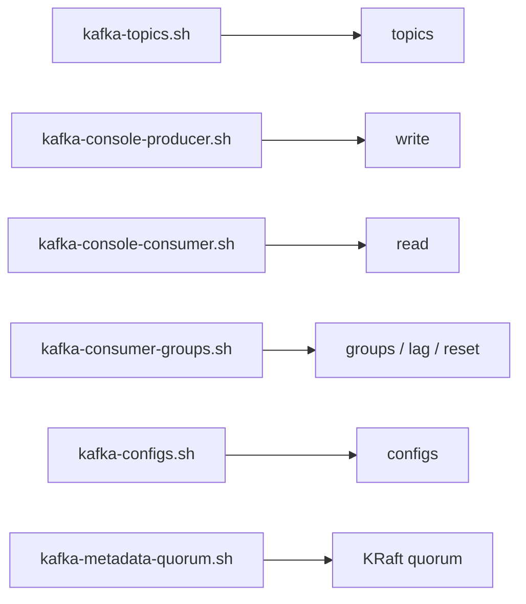

# 31 · CLI Cheatsheet

> كل الأوامر بتشتغل جوّا container: `docker exec -it kafka-1 bash` ثم `cd /opt/kafka/bin`.



```bash
BS=localhost:19092     # internal listener inside the container
```

## Topics
```bash
./kafka-topics.sh --bootstrap-server $BS --list
./kafka-topics.sh --bootstrap-server $BS --create --topic t1 --partitions 6 --replication-factor 3 \
  --config min.insync.replicas=2
./kafka-topics.sh --bootstrap-server $BS --describe --topic t1
./kafka-topics.sh --bootstrap-server $BS --describe --under-replicated-partitions
./kafka-topics.sh --bootstrap-server $BS --alter --topic t1 --partitions 12
./kafka-topics.sh --bootstrap-server $BS --delete --topic t1
```

## Produce / Consume
```bash
# key:value
./kafka-console-producer.sh --bootstrap-server $BS --topic t1 \
  --property parse.key=true --property key.separator=:
> alice:hello

./kafka-console-consumer.sh --bootstrap-server $BS --topic t1 --from-beginning \
  --property print.key=true --property print.partition=true --property print.offset=true \
  --property print.headers=true --group cli-reader
```

## Consumer groups
```bash
./kafka-consumer-groups.sh --bootstrap-server $BS --list
./kafka-consumer-groups.sh --bootstrap-server $BS --describe --group demo-reader       # lag
./kafka-consumer-groups.sh --bootstrap-server $BS --describe --group demo-reader --members
./kafka-consumer-groups.sh --bootstrap-server $BS --group demo-reader --topic demo.orders \
  --reset-offsets --to-earliest --execute     # also --dry-run
```

## Configs
```bash
./kafka-configs.sh --bootstrap-server $BS --entity-type topics --entity-name t1 --describe
./kafka-configs.sh --bootstrap-server $BS --entity-type topics --entity-name t1 \
  --alter --add-config retention.ms=86400000
```

## Cluster / KRaft
```bash
./kafka-metadata-quorum.sh --bootstrap-server $BS describe --status
./kafka-metadata-quorum.sh --bootstrap-server $BS describe --replication
./kafka-broker-api-versions.sh --bootstrap-server $BS | grep id:
```

## Debug
```bash
./kafka-dump-log.sh --print-data-log --files /tmp/kafka-logs/t1-0/00000000000000000000.log
./kafka-get-offsets.sh --bootstrap-server $BS --topic t1          # end offsets per partition
./kafka-producer-perf-test.sh --topic t1 --num-records 100000 --record-size 512 \
  --throughput -1 --producer-props bootstrap.servers=$BS acks=all linger.ms=20 compression.type=lz4
```

Next → [32-partition-sizing.md](32-partition-sizing.md)
