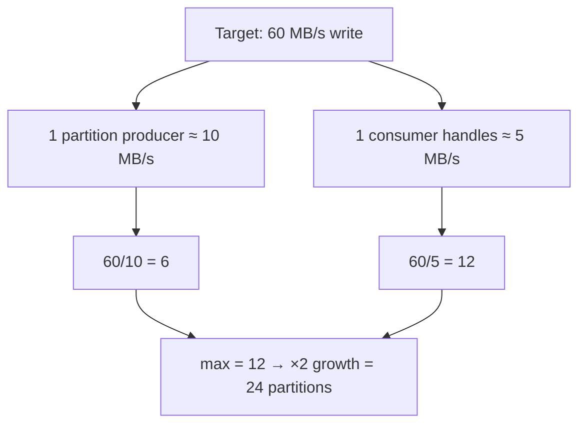

# 32 · Sizing: كم partition؟ كم broker؟

> partitions = max(throughput ÷ throughput-per-partition, عدد الـ consumers اللي بدك ياهم بالتوازي) + مساحة للنمو.



## Formula
```text
P = max( T / Tp , T / Tc ) × growth
T  = target throughput
Tp = throughput per partition (producer side)  ~ 10-50 MB/s
Tc = throughput per consumer                    ~ depends on YOUR handler
```

## مثال عملي
| Input | Value |
|---|---|
| Orders peak | 3,000 msg/s |
| Avg size | 1 KB → 3 MB/s |
| Handler time | 5 ms/msg ⇒ 200 msg/s per consumer |
| Needed consumers | 3000 / 200 = **15** |
| Partitions | 15 → round up **18** (يتقسم على 1,2,3,6,9) |

→ الـ bottleneck غالباً **الـ consumer handler**، مش Kafka.

## Trade-offs
| Partitions كثيرة | Partitions قليلة |
|---|---|
| ✅ توازي أعلى | ✅ overhead أقل |
| ❌ files + memory أكثر | ❌ ما بتقدر تـ scale consumers |
| ❌ failover / rebalance أبطأ | ❌ hot partitions |
| ❌ end-to-end latency أعلى شوي | |

## Broker sizing
```text
Storage = write MB/s × 86400 × retention days × RF ÷ brokers
Example: 10 MB/s × 86400 × 7 × 3 = 18 TB  ÷ 3 brokers = 6 TB/broker (+30% headroom)
```

## Rules of thumb
| Rule | Value |
|---|---|
| Partitions per broker | ≤ 4000 |
| Start small topic | 6 (أو 12) |
| Multiple of consumers | 6, 12, 24 (يتقسم بسهولة) |
| Brokers min | 3 |

## Key Points
- قيس الـ handler قبل ما تختار
- زيادة partitions لاحقاً = كسر ترتيب الـ keys
- اختار عدد بيتقسم كويس

Next → [33-kafka-4x-new-features.md](33-kafka-4x-new-features.md)
