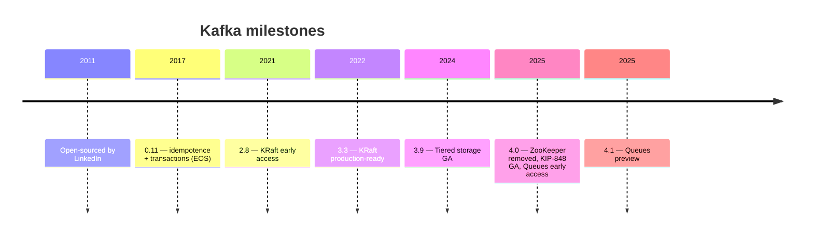
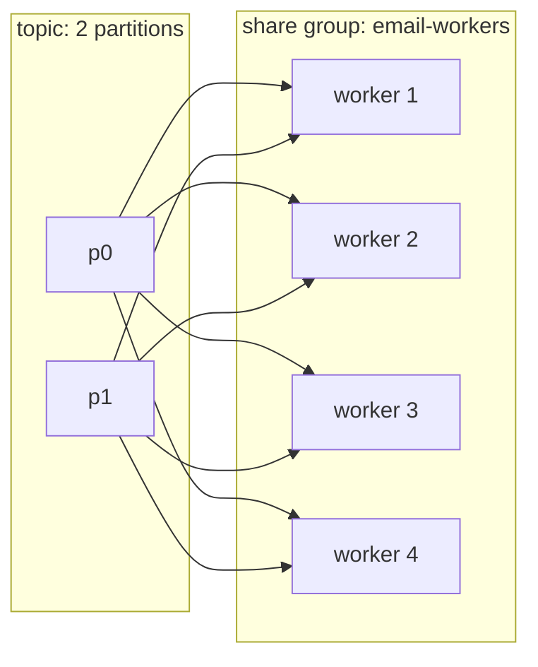

# 33 · Kafka 4.x: الجديد

> Kafka 4.0 (Mar 2025) = أكبر تغيير من سنين: **بدون ZooKeeper**، consumer protocol جديد، وبداية **Queues**.



## 1) ZooKeeper removed → [04-kraft.md](../01-foundations/04-kraft.md)
- Upgrade من 3.x ZK ⇒ لازم migration لـ KRaft على 3.9 أول.

## 2) KIP-848: Next-gen rebalance protocol
```csharp
config.Set("group.protocol", "consumer");
```
- الـ broker بيحسب الـ assignment، ما في stop-the-world → [17](../04-consumer/17-rebalancing.md)

## 3) KIP-932: Queues for Kafka (Share Groups)

| | Consumer Group | Share Group |
|---|---|---|
| Partition → consumers | 1 | **كثير** |
| Max parallelism | = partitions | > partitions ✅ |
| Ack | offset (ترتيبي) | **per record** (accept/release/reject) |
| Ordering | ✅ per partition | ❌ |
| Redelivery | seek | تلقائي + delivery count |
| Use | event streams | **job queues** (مثل RabbitMQ) |

> الحالة: early access بـ 4.0، preview بـ 4.1 — تأكد من دعم الـ client (librdkafka) قبل الاستخدام بـ prod.

## 4) Tiered Storage (3.9 GA) → [21](../06-storage/21-retention-compaction.md)

## 5) تغييرات تكسر
| Change | Impact |
|---|---|
| Java 17 للـ brokers، Java 11 للـ clients | upgrade JVM |
| Message format v0/v1 removed | clients قديمة جداً (< 0.11) ما بتشتغل |
| Old client protocol versions removed | librdkafka ≥ 2.x ✅ |

## Key Points
- جديد = KRaft فقط
- Share groups ≈ queue semantics
- KIP-848 = rebalances شبه مجانية

Next → [34-scaling-consumers-partitions.md](../09-scaling/34-scaling-consumers-partitions.md)
