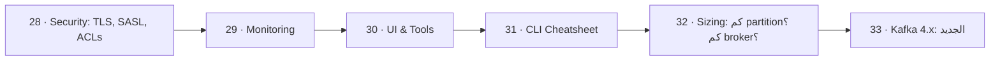

# 🛠️ 08 · Operations — التشغيل

> security، monitoring، UI، CLI، sizing، Kafka 4.x

| # | Idea | One line |
|---|---|---|
| 28 | [Security: TLS, SASL, ACLs](28-security.md) | 3 طبقات: **Encryption** (TLS) + **Authentication** (SASL/mTLS) + **Authorization** (ACLs). |
| 29 | [Monitoring](29-monitoring.md) | أهم رقم بالكون: **consumer lag**. بعده: under-replicated partitions و request latency. |
| 30 | [UI & Tools](30-ui-tools.md) | أدوات تشوف فيها الـ topics والرسائل والـ groups والـ lag بدل الـ CLI. |
| 31 | [CLI Cheatsheet](31-cli-cheatsheet.md) | كل الأوامر بتشتغل جوّا container: `docker exec -it kafka-1 bash` ثم `cd /opt/kafka/bin`. |
| 32 | [Sizing: كم partition؟ كم broker؟](32-partition-sizing.md) | partitions = max(throughput ÷ throughput-per-partition, عدد الـ consumers اللي بدك ياهم بالتوازي) + مساحة للنمو. |
| 33 | [Kafka 4.x: الجديد](33-kafka-4x-new-features.md) | Kafka 4.0 (Mar 2025) = أكبر تغيير من سنين: **بدون ZooKeeper**، consumer protocol جديد، وبداية **Queues**. |

← [Integration Patterns](../07-integration-patterns/README.md) · [Map](../../README.md) · [Scaling](../09-scaling/README.md) →
