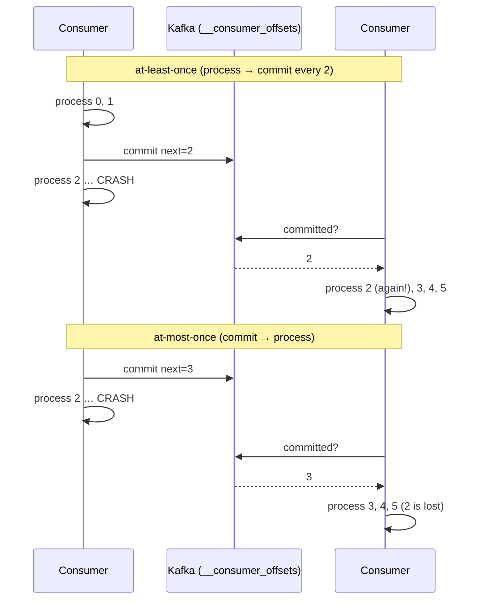

# 09 · Offset commits

**Definition:** A **commit** stores "the next offset to read" for a group and partition in the internal topic `__consumer_offsets`.

**Why it matters:** Where you commit relative to processing decides your consumer guarantee: commit **after** = at-least-once (duplicates on crash), commit **before** = at-most-once (loss on crash).

## Example

```
Initial data:
  topic                : 09-invoices, 1 partition, invoice-0 … invoice-5
  crash point          : while processing offset 2

Commands:
  at-least-once run 1  : process 0,1 → commit next=2 → crash on 2
  at-least-once run 2  : resumes at 2 → processes 2,3,4,5
  at-most-once run 1   : commit next=1,2,3 before processing → crash on 2
  at-most-once run 2   : resumes at 3 → processes 3,4,5

Result:
  at-least-once        : invoice-2 handled twice (duplicate, nothing lost)
  at-most-once         : invoice-2 never finished (lost, no duplicate)
```

## Diagram



| Strategy | Config | Guarantee |
|---|---|---|
| Auto commit (default) | `enable.auto.commit=true` | Usually at-least-once, but can commit unprocessed records if you buffer |
| Manual, after processing | `EnableAutoCommit=false` + `Commit()` | At-least-once |
| Manual, before processing | `Commit()` first | At-most-once |
| Store + auto commit | `EnableAutoOffsetStore=false` + `StoreOffset(record)` | At-least-once, batched commits (best default) |
| In a transaction | `SendOffsetsToTransaction` | Exactly-once (Kafka→Kafka) |

## Code

[examples/09-offset-commits/Program.cs](../examples/09-offset-commits/Program.cs)

```csharp
if (commitBeforeProcessing)
{
    consumer.Commit(record);
}

if (offset == crashAtOffset)
{
    break;   // simulated crash
}

Console.WriteLine($"   offset {offset}: processed {record.Message.Value}");

if (!commitBeforeProcessing && offset % 2 == 1)
{
    consumer.Commit(record);   // commits record.Offset + 1
}
```

Output:

```text
== at-least-once: process, then commit ==
-- consumer started (will crash at offset 2)
   offset 0: processed invoice-0
   offset 1: processed invoice-1
   commit -> next offset 2
   offset 2: CRASH while processing invoice-2
-- consumer started (runs to end)
   offset 2: processed invoice-2
   offset 3: processed invoice-3
   commit -> next offset 4
   offset 4: processed invoice-4
   offset 5: processed invoice-5
   commit -> next offset 6

== at-most-once: commit, then process ==
-- consumer started (will crash at offset 2)
   offset 0: processed invoice-0
   offset 1: processed invoice-1
   offset 2: CRASH while processing invoice-2
-- consumer started (runs to end)
   offset 3: processed invoice-3
   offset 4: processed invoice-4
   offset 5: processed invoice-5
```

## ✅ Correct vs ❌ wrong usage

| | Usage | Reason |
|---|---|---|
| ✅ | At-least-once + **idempotent processing** (upsert, dedupe table by event id) | Duplicates become harmless |
| ✅ | `EnableAutoOffsetStore=false` + `StoreOffset` after processing | Only processed records are committed; commits still batched |
| ❌ | `Commit()` after **every** record at high volume | One synchronous round trip per record, very slow |
| ❌ | Commit, then hand the record to a background thread | Crash = loss: the offset is ahead of the work |

## Pitfalls

1. The committed value is **next offset to read** (`record.Offset + 1`). `Commit(record)` does the +1 for you; `Commit(offsets)` does not.
2. Committed offsets of an empty group expire after `offsets.retention.minutes` (7 days) → `auto.offset.reset` kicks in.
3. A rebalance between process and commit causes re-delivery; commit in the revoked handler.
4. Reset a group with `kafka-consumer-groups.sh --reset-offsets` only while it is stopped.

**Next:** [10 · Serialization & Schema Registry](10-serialization-schema-registry.md)
