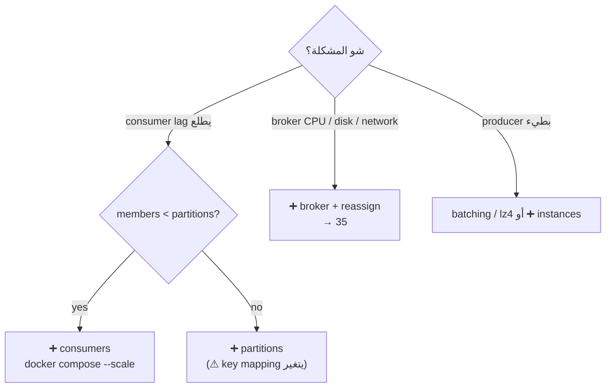
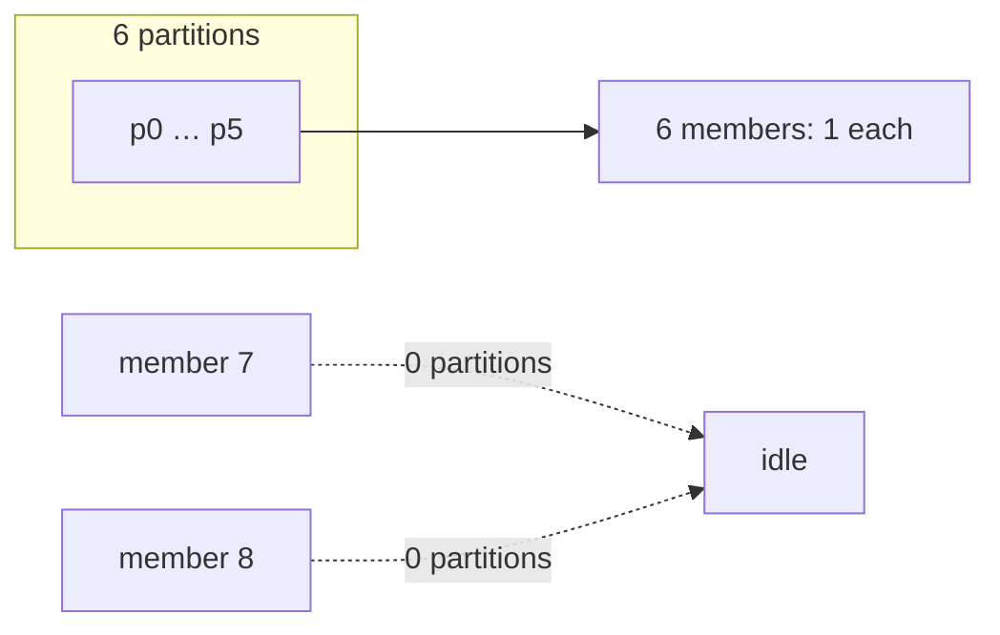

# 34 · Scale Out: Consumers & Partitions

> Kafka بتتوسع على 4 محاور. **الـ partitions هي السقف**: consumers فعالين بالـ group ≤ عدد partitions.



## المحاور
| Scale | كيف | تلقائي؟ | السقف |
|---|---|---|---|
| Producers | instances أكثر | ✅ stateless | الـ brokers |
| **Consumers** | members أكثر بنفس `group.id` | ✅ rebalance | **= partitions** |
| **Partitions** | `--alter --partitions` | نص-نص (metadata refresh) | ما بتنقص أبداً |
| **Brokers** | node جديد + reassign | ❌ يدوي | → [35](35-scaling-brokers.md) |

## 1) Consumers بـ Docker
```yaml
# docker/docker-compose.scale.yml — no container_name, no host ports ⇒ scalable
inventory:
  image: kafka-example-13
  command: ["inventory"]
  environment:
    KAFKA_BOOTSTRAP: "kafka-1:19092,kafka-2:19092,kafka-3:19092"
```
```bash
C="docker compose -f docker/docker-compose.yml -f docker/docker-compose.scale.yml -p kafka-learn"
$C up -d --scale inventory=3 inventory
docker exec kafka-1 /opt/kafka/bin/kafka-consumer-groups.sh \
  --bootstrap-server localhost:19092 --describe --group inventory-service --members
```

## Output حقيقي (topic = 6 partitions)
| `--scale` | التوزيع | Idle |
|---|---|---|
| 3 | `0,1` · `3,5` · `2,4` | 0 |
| 8 | 1 × 6 members | **2 ❌** |



## 2) Partitions: 6 → 12
```bash
docker exec kafka-1 /opt/kafka/bin/kafka-topics.sh --bootstrap-server localhost:19092 \
  --alter --topic shop.order.created --partitions 12
```
Output حقيقي:
| | Before (6) | After (12) |
|---|---|---|
| 8 members | 6 × 1 + **2 × 0 (idle)** | **4 × 2 + 4 × 1** (ولا واحد idle) |
| key `c-1` | p5 | ممكن partition تاني ⚠ |

> الـ consumers ما شافوا الـ partitions الجديدة فوراً: استنوا الـ metadata refresh (librdkafka `topic.metadata.refresh.interval.ms` = **5 min** default). القياس: كل الـ 12 اتوزعوا خلال < 5 دقائق.

## ⚠ Ordering عند زيادة partitions
```text
before: murmur2("c-1") % 6  = 5
after:  murmur2("c-1") % 12 = 5 or 11
→ old c-1 events in p5, new may go to p11 → two consumers → order across the switch NOT guaranteed
```
✅ Over-provision من الأول (12/24) أو topic جديد + migration.

## 3) Scale in
```bash
$C up -d --scale inventory=2 inventory   # SIGTERM → Close() → LeaveGroup → rebalance فوري
```
Output حقيقي: 8 → 2 خلال **8s**، والباقيين أخدوا `6 + 6` partitions فوراً.
```csharp
// Common/Cluster.cs — بدون هيك، docker stop = SIGKILL بعد 10s بدون Close()
PosixSignalRegistration.Create(PosixSignal.SIGTERM, ctx => { ctx.Cancel = true; cts.Cancel(); });
```
> بدون SIGTERM handling: الـ container بيموت بعد 10s، والـ partitions محجوزة لحد `session.timeout.ms` (45s).

## Key Points
- scale consumers أول، partitions تاني، brokers آخر
- consumers > partitions = هدر
- خطط عدد الـ partitions للنمو

Next → [35-scaling-brokers.md](35-scaling-brokers.md)
